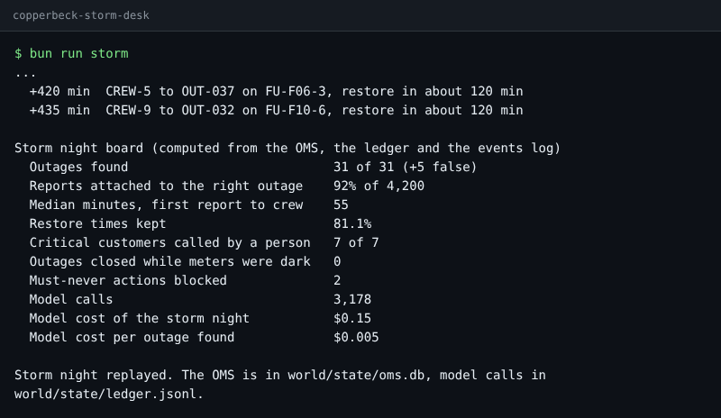
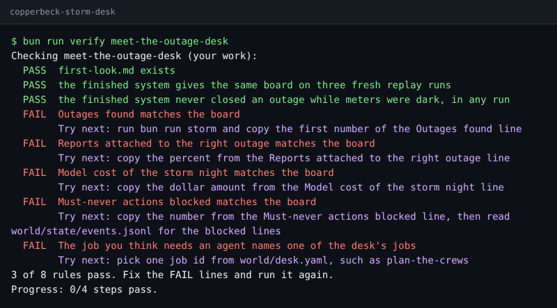

# Start here

You will set up the repo, meet Copperbeck Power's storm desk, run the finished system and see your goal.
It takes about 15 minutes, and needs no model key.

## 1. Set up (4 minutes)

You need [Bun](https://bun.sh) and git. Then, in the repo folder:

```bash
bun install
```

Expect: `bun install` ends with no errors.

```bash
bun run models
```

Expect: `Every role answers.` The default provider is `replay`: recorded model replies, no key, no cost.

To run live later, copy `.env.example` to `.env`, set `LLM_PROVIDER` to `anthropic`, `openrouter` or
`openai`, and fill in that one key. Nothing in this course needs it.

## 2. Meet the world (5 minutes)

```bash
bun run world reset
```

Expect: `World reset: world/state/oms.db seeded from world/seed/.` and then `The world is ready. Next: bun run storm`

Read [world/README.md](../world/README.md) (the network, the data, the OMS) and
[world/policy.md](../world/policy.md) (the four rules every design must respect).

## 3. Run the finished system (4 minutes)

```bash
bun run storm
```

Expect: a timeline of outages opened, crews sent and two `BLOCKED` lines, then `Storm night replayed.`

The sample design groups the reports with a workflow, writes customer texts with one model call, plans crews
with an agent, and leaves switching to a person. Its board:



Two numbers to notice. The agent tried twice to close an outage on the crew's word while smart meters behind
it were still dark; a check in code blocked it both times. And the whole night of model calls cost cents,
while 8% of reports still landed on the wrong outage.

## 4. See the goal (2 minutes)

Your job across the four parts: write a design for this desk that beats this board, or explains why it
cannot, and defend it with numbers. Your first check is the orientation step:

```bash
bun run verify meet-the-outage-desk
```

Expect: `FAIL` lines, each with a `Try next:` line. That is the starting point; every step begins failing.



Now open [the step](../parts/00-meet-the-desk/01-meet-the-outage-desk/problem/README.md) and make it pass.

When a command prints something you do not expect, look it up in [troubleshooting.md](troubleshooting.md).
