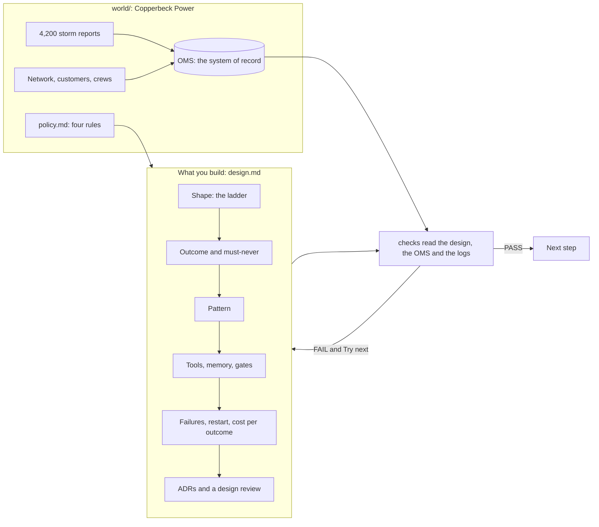

# Agentic AI System Design for Engineers & PMs

In this course, you write a design doc for a real agentic system. An agentic system is software where an
AI model chooses some of its own next steps.

Your design doc answers four questions. Should each job be an agent at all? What must it never do? Where
does a person say yes? And what does each good result cost? A script checks every part of your doc.

**Who it is for.** This course is for engineers who must design an agent system. It is also for product
managers (PMs) who must approve one.

You do not need to be a coder. Each thing you hand in is a Markdown file with a small YAML block. YAML is
a simple text format of `name: value` lines. The cost calculator is one command.

If you are a senior engineer who reviews agent designs, you get more too. You get rules that link the
parts of a design, a cost model and a review of real systems.

**The world.** The course is set in a made-up company, Copperbeck Power. It brings power to homes in one
region. You work on its storm outage desk, the team that handles power cuts on a storm night.

For example, in one storm night the desk gets 4,200 reports. A substation is a site that sends power out
to the streets. A feeder is one power line that leaves a substation and runs down many streets.

The desk serves 9,000 customers on 12 feeders. It has 9 repair crews and 9 critical customers, such as a
hospital. The desk's operations director asked for "an AI agent for storm nights".

## Run the finished system

You do not need a model key. The course runs in replay mode. Replay mode plays back model replies that
were recorded before, so it costs nothing.

```bash
bun install
```

Expect: `bun install` ends with no errors.

```bash
bun run world reset
```

Expect: `The world is ready. Next: bun run storm`

```bash
bun run storm
```

Expect: `Storm night replayed.` under the board below.


For example, the board ends with these lines. Two lines say what went well and what it cost.

```text
  Must-never actions blocked              2
  Model calls                             3,178
  Model cost of the storm night           $0.15
```

So the whole night of model calls cost 15 cents. Twice, a check in the code stopped the agent from
breaking a rule.

```bash
bun run verify meet-the-outage-desk solution
```

Expect: `Done. All 8 rules pass.`

The picture below shows the whole course. On the left is the world. On the right is what you build. The
checks read both.



A few words from the picture:

- The OMS is the outage management system. It is the database that holds the truth about every outage.
- The ladder lists the ways to do a job, from plain code up to a full agent. Each level is a rung.
- An agent is a model that picks its own next step and calls tools.
- A workflow is a fixed list of steps that your code runs in order.
- An ADR is an architecture decision record. It is a short page that says what you chose and why.

## How the course works

1. Start in [00-orientation](00-orientation/README.md). There you set up, meet the world and run the
   finished system.
2. Each part in `parts/` opens with a real problem, a public number and a diagram.
3. Each step has a challenge, a Done when list and one command: `bun run verify <step-name>`.
4. Every step folder has three folders. You work in `problem/`. `solution/` holds a sample answer.
   `wrong/` holds common mistakes that the check rejects.
5. `bun run verify part <part-name>` checks a whole part.
6. `bun run verify --report` writes `verify-report.json`. Teachers use it to grade a whole class.

For example, `bun run verify meet-the-outage-desk` prints one line per rule. On a new copy of the
course, it ends with `3 of 8 rules pass. Fix the FAIL lines and run it again.`

| Part                                                                              | Steps                                                               | Minutes | You produce                                                |
| --------------------------------------------------------------------------------- | ------------------------------------------------------------------- | ------- | ---------------------------------------------------------- |
| [Meet the desk](parts/00-meet-the-desk/README.md)                                 | `meet-the-outage-desk`                                              | 15      | `first-look.md`: the board's numbers in your words         |
| [Choose the shape](parts/01-choose-the-shape/README.md)                           | `place-on-the-ladder`, `write-the-outcome`, `pick-the-pattern`      | 60      | Shape, Outcome and Pattern sections                        |
| [Design the agent](parts/02-design-the-agent/README.md)                           | `scope-the-tools`, `map-the-memory`, `place-the-gates`              | 60      | Tools, Memory and Gates sections                           |
| [Plan for failure and cost](parts/03-plan-for-failure-and-cost/README.md)         | `name-the-failures`, `design-the-restart`, `price-the-outcome`      | 60      | Failures and Restart sections, `cost.yaml`                 |
| [Decide and defend](parts/04-decide-and-defend/README.md)                         | `record-the-decisions`, `review-a-real-system`, `defend-the-design` | 60      | Three ADRs, a review of a real system, a review request    |
| [Price the design with LiteLLM](parts/05-price-the-design-with-litellm/README.md) | `price-the-design`                                                  | 15      | `sheet.csv`: your hand estimate redone with LiteLLM prices |

All five parts are ready. [PARTS.md](PARTS.md) lists every step and what its check reads.
[schedules.toml](schedules.toml) shows how the parts fit into different course lengths.

## The project

Your project is a public repo with your design of the Copperbeck storm desk. You can also design your own
world.

Two other worlds use the same headings. In the first, a hospital's bed desk finds beds for patients from
the emergency department. In the second, a home insurer's desk sorts storm claims after a hailstorm.

A list of yes or no questions in [rubric.md](rubric.md) grades the project. The script answers most of
them. A person answers the rest.

A reviewer looks for four things in the first minute:

- The ladder, with at least one job left as a plain workflow.
- One sentence the system must never break.
- The cost per outcome next to the value per outcome.
- Three decisions, each with a way to check it.

## Read before you start

| Read                                                                                                                         | Why                                                                 | Minutes |
| ---------------------------------------------------------------------------------------------------------------------------- | ------------------------------------------------------------------- | ------- |
| [Building effective agents](https://www.anthropic.com/research/building-effective-agents), Anthropic                         | The ladder and the workflow patterns this course uses               | 15      |
| [How we built our multi-agent research system](https://www.anthropic.com/engineering/multi-agent-research-system), Anthropic | What many agents really cost: about 15 times the tokens of a chat   | 20      |
| [Writing effective tools for agents](https://www.anthropic.com/engineering/writing-tools-for-agents), Anthropic              | What a tool is, and why fewer, clearer tools work better            | 15      |
| [Freedom Forever customer story](https://claude.com/customers/freedom-forever), a vendor claim                               | A cost per outcome from a real system: $0.20 to $0.35 per execution | 5       |

A token is a small piece of text, about three quarters of a word. Model companies charge by the token.

## Models

All model calls go through [config/models.ts](config/models.ts). That file names roles (`fast`, `smart`,
`judge`). It never names the places in the code that call them.

`LLM_PROVIDER` is `replay` by default. To run with a live model, set it to `anthropic`, `openrouter` or
`openai`. Then put one key in `.env` (see `.env.example`).

The replay replies in `world/replay/` come from `world/build-replay.ts`. That file is a script that acts
like the model; its header says how. With a key, `bun run storm --record` swaps them for replies from a
live model.

[STANDARD.md](STANDARD.md) lists the rules every course repo follows, and the check behind each one.
