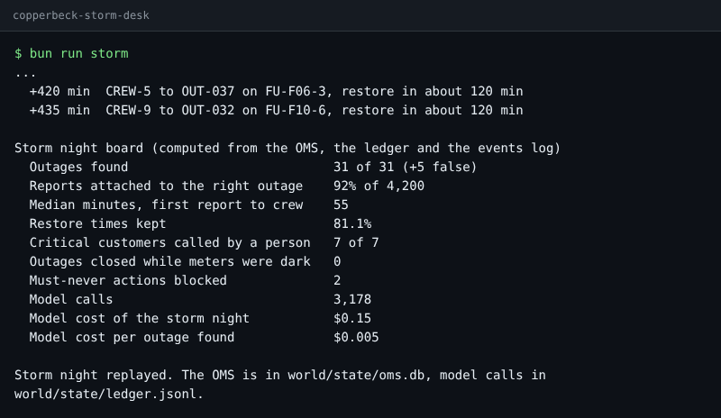
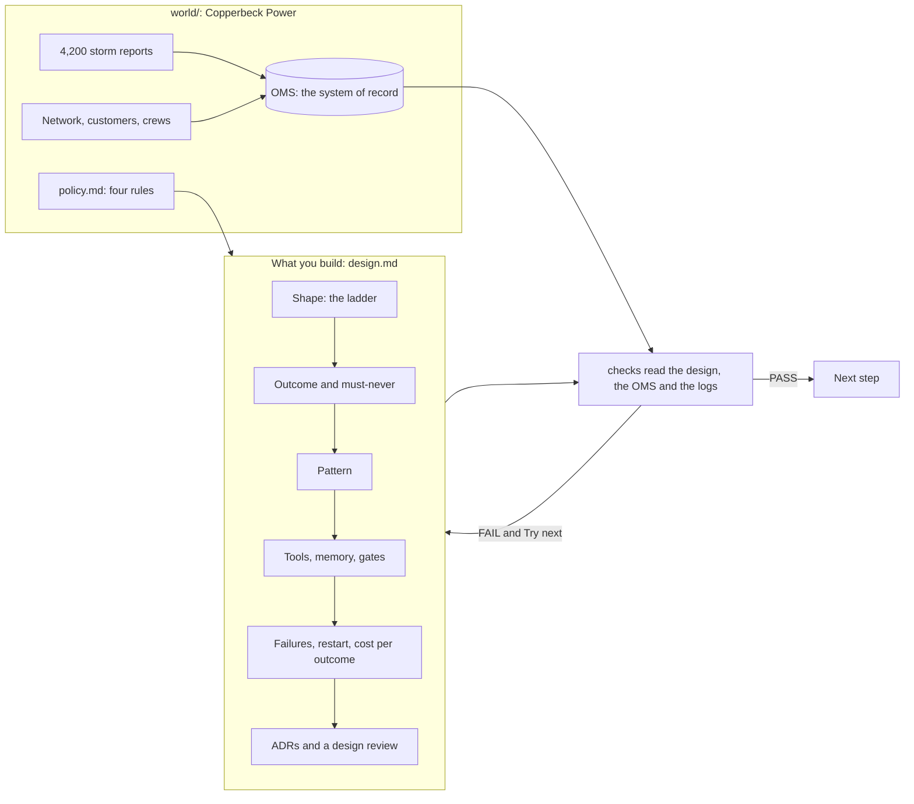

# Agentic AI System Design for Engineers & PMs

You leave with a design doc for a real agentic system: whether each job should be an agent at all, what it
must never do, where people sign off, and what each outcome costs. A script checks every section.

**Who it is for.** Engineers who must design an agent system, and product managers who must sign one off.
A PM who has never read an architecture decision record can finish every step: each deliverable is Markdown
with a small YAML block, and the cost calculator is one command. A staff engineer who reviews agent designs
gets cross-section rules, a cost model and a design review of real systems.

**The world.** Copperbeck Power, a regional electricity distributor (fictional), and its storm outage desk:
4,200 reports in one storm night, 9,000 customers, 12 feeders, 9 crews, 9 critical customers, and an
operations director who asked for "an AI agent for storm nights".

## Run the finished system

No model key is needed. Replay mode plays back recorded model replies.

```bash
bun install
```

Expect: `bun install` ends with no errors.

```bash
bun run world reset
```

Expect: `The world is ready. Next: bun run storm`

```bash
bun run storm
```

Expect: `Storm night replayed.` under the board below.



```bash
bun run verify meet-the-outage-desk solution
```

Expect: `Done. All 8 rules pass.`



## How the course works

1. Start in [00-orientation](00-orientation/README.md): set up, meet the world, run the finished system.
2. Each part in `parts/` opens with a real problem, a public number and a diagram.
3. Each step has a challenge, a Done when list and one command: `bun run verify <step-name>`. Every step
   folder holds `problem/` (where you work), `solution/` (a sample) and `wrong/` (common mistakes the check
   rejects).
4. `bun run verify part <part-name>` checks a whole part. `bun run verify --report` writes
   `verify-report.json` for cohort grading.

| Part | Steps | Minutes | You produce |
|---|---|---|---|
| [Meet the desk](parts/00-meet-the-desk/README.md) | `meet-the-outage-desk` | 15 | `first-look.md`: the board's numbers in your words |
| [Choose the shape](parts/01-choose-the-shape/README.md) | `place-on-the-ladder`, `write-the-outcome`, `pick-the-pattern` | 60 | Shape, Outcome and Pattern sections |
| [Design the agent](parts/02-design-the-agent/README.md) | `scope-the-tools`, `map-the-memory`, `place-the-gates` | 60 | Tools, Memory and Gates sections |
| [Plan for failure and cost](parts/03-plan-for-failure-and-cost/README.md) | `name-the-failures`, `design-the-restart`, `price-the-outcome` | 60 | Failures and Restart sections, `cost.yaml` |
| [Decide and defend](parts/04-decide-and-defend/README.md) | `record-the-decisions`, `review-a-real-system`, `defend-the-design` | 60 | Three ADRs, a review of a real system, a review request |

Parts 2 to 4 are being built; [PARTS.md](PARTS.md) lists every step and what its check reads.
[schedules.toml](schedules.toml) maps the parts onto formats.

## The project

A public repo with your design of the Copperbeck storm desk, or of your own world. Two alternate worlds
work with the same headings: a hospital's bed desk placing patients from the emergency department, and a
home insurer's storm claims desk sorting first notices of loss after a hailstorm. The project is graded
by the binary questions in [rubric.md](rubric.md): the script answers most of them, a grader answers the rest.

What a reviewer sees in a minute: the ladder with at least one job left as a plain workflow, one sentence
the system must never break, the cost per outcome next to the value per outcome, and three decisions that
each name how they will be checked.

## Read before you start

| Read | Why | Minutes |
|---|---|---|
| [Building effective agents](https://www.anthropic.com/research/building-effective-agents), Anthropic | The ladder and the workflow patterns this course uses | 15 |
| [How we built our multi-agent research system](https://www.anthropic.com/engineering/multi-agent-research-system), Anthropic | What many agents really cost: about 15 times the tokens of a chat | 20 |
| [Writing effective tools for agents](https://www.anthropic.com/engineering/writing-tools-for-agents), Anthropic | What a tool is, and why fewer, clearer tools win | 15 |
| [Freedom Forever customer story](https://claude.com/customers/freedom-forever), a vendor claim | A cost per outcome from a real system: $0.20 to $0.35 per execution | 5 |

## Models

All model calls go through [config/models.ts](config/models.ts), which names roles (`fast`, `smart`,
`judge`), never call sites. `LLM_PROVIDER` is `replay` by default. Set it to `anthropic`, `openrouter` or
`openai` and fill one key in `.env` (see `.env.example`) to run live. The replay replies in
`world/replay/` were built by `world/build-replay.ts`, a scripted stand-in for the model (see that file's
header); with a key, `bun run storm --record` replaces them with replies recorded from a live model.

The rules every course repo follows, and the check behind each, are in [STANDARD.md](STANDARD.md).
