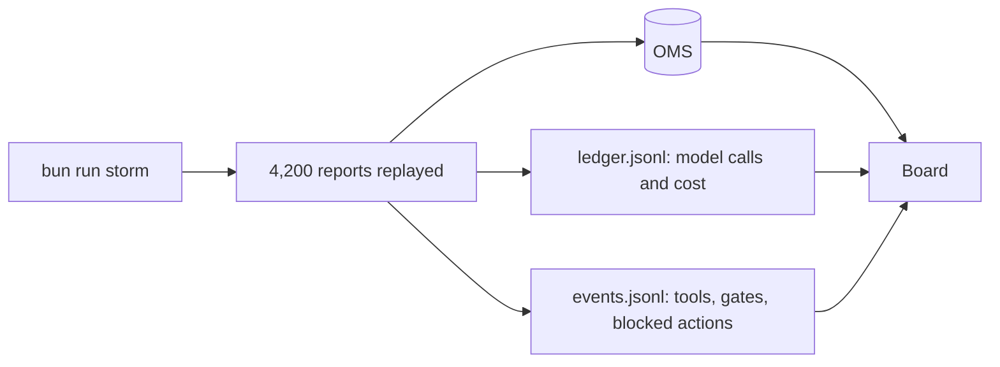

# Meet the outage desk

## The problem

You cannot design a system for a desk you have never watched. Before you write a line of design, run the
finished sample design through one storm night at Copperbeck Power and read what it achieved, what it cost,
and what it was stopped from doing.



## Your challenge

1. Read `world/README.md` and `world/policy.md`.
2. Run the finished system:

```bash
bun run storm
```

Expect: the timeline, then `Storm night replayed.` under a board like the one below.


3. Open `first-look.md` in this folder and copy five things from the board: outages found, reports attached
   to the right outage, model cost of the storm night, must-never actions blocked, and the one job you think
   needs an agent (a job id from `world/desk.yaml`).
4. Open `world/state/events.jsonl` and find the lines with `"kind":"blocked"`. Each one is the agent trying
   to close an outage while smart meters behind it were still dark.

## Done when

- `first-look.md` exists in this folder.
- The finished system gives the same board on three fresh replay runs, and never closes an outage while
  meters are dark.
- Your four numbers match the board.
- You named one of the desk's four jobs.

```bash
bun run verify meet-the-outage-desk
```

Expect: `Done. All 8 rules pass.` and a `Progress:` line.

## If you get stuck

| What you see | Fix |
|---|---|
| `FAIL first-look.md exists` | The file goes in this `problem/` folder, next to this README. |
| `FAIL ... matches the board` | Copy the number after the label. `92%` and `92` both work; so do `$0.15` and `0.15`. |
| `FAIL The job you think needs an agent` | Use an id such as `plan-the-crews`, not a description. |
| `The storm run stopped: No recorded reply` | The sample prompts were changed. Run `git checkout finished/`. |

## Words you will use

- **OMS**: the outage management system, Copperbeck's system of record for outages.
- **Replay**: the model replies were saved once and are played back, so no key and no cost are needed.
- **Board**: the summary computed from the OMS and the logs, never from what a model said.
- **Must-never**: an action the system may never take; here, closing an outage while homes are still dark.
