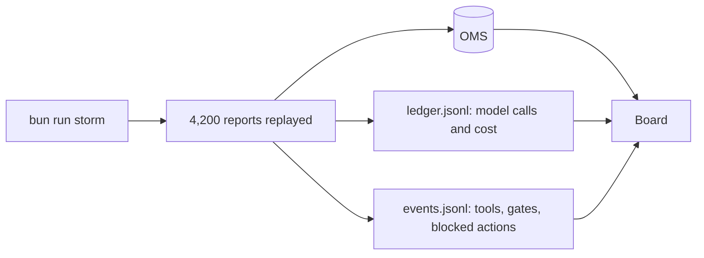
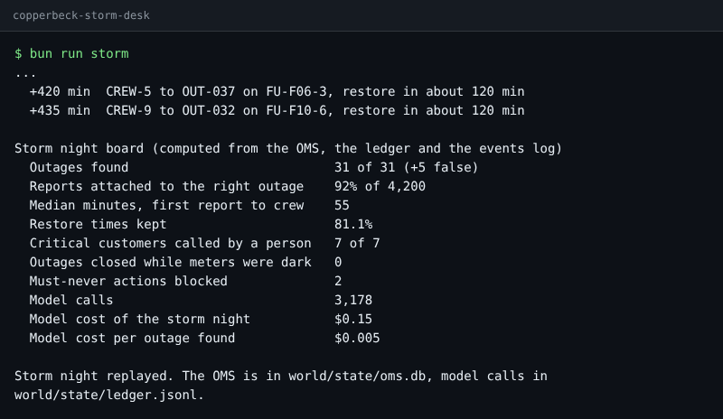

# Meet the outage desk

## The problem

You cannot design a system for a desk you have never watched. So first, you run the finished sample design
through one storm night at Copperbeck Power. Then you read three things: what it did, what it cost, and what
it was stopped from doing.



The ledger logs each model call and its cost. The events log has a line for each tool the system used. It
also logs each gate, a rule in code that can stop an action.

## Your challenge

1. Read `world/README.md` and `world/policy.md`.
2. Run the finished system:

```bash
bun run storm
```

Expect: the timeline, then `Storm night replayed.` under a board like the one below.



3. Open `first-look.md` in this folder. Copy four numbers from the board, each after its label: outages
   found, reports attached to the right outage, model cost of the storm night, and must-never actions
   blocked.
4. On the last line, name the one job you think needs an agent. Use a job id from `world/desk.yaml`.
5. Open `world/state/events.jsonl` and find the lines with `"kind":"blocked"`. Each one is the agent trying
   to close an outage while smart meters behind it were still dark.

For example, a filled `first-look.md` has lines like these:

```text
Outages found: 31 of 31
Model cost of the storm night: $0.15
The job you think needs an agent: plan-the-crews
```

And one blocked line in `events.jsonl` looks like this:

```text
{"run":"run-mwe5heo6","at":240,"kind":"blocked","rule":"P2","tool":"oms_close_outage","by":"agent","args":{"outage":"OUT-028"},"result":"151 smart meters behind R-F01 still dark"}
```

Here the agent tried to close outage `OUT-028`. Rule `P2` stopped it, because 151 smart meters behind it
still had no power. Your `run` id will differ.

## Done when

- `first-look.md` exists in this folder.
- The finished system gives the same board on three fresh replay runs, and never closes an outage while
  meters are dark.
- Your four numbers match the board.
- You named one of the desk's four jobs.

```bash
bun run verify meet-the-outage-desk
```

Expect: `Done. All 8 rules pass.` and a `Progress:` line.

## If you get stuck

| What you see                               | Fix                                                                                  |
| ------------------------------------------ | ------------------------------------------------------------------------------------ |
| `FAIL first-look.md exists`                | Put the file in this `problem/` folder, next to this README.                         |
| `FAIL ... matches the board`               | Copy the number after the label. `92%` and `92` both work. So do `$0.15` and `0.15`. |
| `FAIL The job you think needs an agent`    | Write a job id such as `plan-the-crews`, not a description.                          |
| `The storm run stopped: No recorded reply` | Someone changed the sample prompts. Run `git checkout finished/` to bring them back. |

## Words you will use

- **OMS**: the outage management system. It is Copperbeck's true record of every outage.
- **Replay**: the model replies were saved once and are played back. You need no key, and it costs nothing.
- **Board**: the summary that code builds from the OMS and the logs, never from what a model said.
- **Must-never**: an action the system may never take. Here, it is closing an outage while homes are still
  dark.
- **Agent**: a loop where the model picks the next step and calls tools until it decides it is done.
