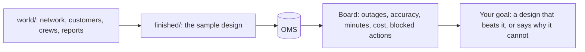

# Meet the desk

## The problem

Copperbeck Power's storm desk gets 4,200 reports in one storm night: phone calls, texts, web forms and smart
meter alarms. Nine crews, nine critical customers, and an operations director who wants "an AI agent". You
start by watching the sample design handle that night, so every later decision has a number to beat.



| Step | Minutes | What the check reads |
|---|---|---|
| `meet-the-outage-desk` | 15 | Three fresh replay runs of the finished system (OMS, ledger, events), and your `first-look.md` |

## Walkthrough

```bash
bun run world reset
```

Expect: `World reset: world/state/oms.db seeded from world/seed/.`

```bash
bun run storm
```

Expect: `Storm night replayed.`

```bash
bun run verify meet-the-outage-desk
```

Expect: `Done. All 8 rules pass.` once `first-look.md` holds the board's numbers.
