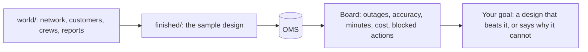

# Meet the desk

## The problem

Copperbeck Power is a made-up power company. Its storm desk is the team that handles power cuts on a storm
night. In one storm night, the desk gets 4,200 reports. They come as phone calls, texts, web forms and smart
meter alarms.

A smart meter is a box at a home that tells the company when the power is off. The desk has nine crews and
nine critical customers. A crew is a team that goes out and fixes the lines. A critical customer is a place
such as a hospital or a care home.

The operations director wants "an AI agent". Before you design anything, you watch the sample design handle
that night. The sample design is a finished answer that comes with the course, in `finished/`. Its numbers
give every later choice a number to beat.

The OMS is the outage management system. It is the place where Copperbeck keeps the true list of outages.
The board is a short summary of the night. Code builds it from the OMS and the logs, not from what a model
said.



For example, after you run `bun run storm`, the board ends with lines like these:

```text
  Outages found                           31 of 31 (+5 false)
  Reports attached to the right outage    92% of 4,200
  Must-never actions blocked              2
  Model cost of the storm night           $0.15
```

So the sample design found all 31 outages for 15 cents. Twice, the system stopped it from doing something it
must never do. Your design has to do at least as well, or explain why it cannot.

| Step                   | Minutes | What the check reads                                                                           |
| ---------------------- | ------- | ---------------------------------------------------------------------------------------------- |
| `meet-the-outage-desk` | 15      | Three fresh replay runs of the finished system (OMS, ledger, events), and your `first-look.md` |

## Walkthrough

First, put the world back to its starting state.

```bash
bun run world reset
```

Expect: `World reset: world/state/oms.db seeded from world/seed/.`

Next, play the storm night. This is a replay: the model replies were saved once, so you need no key and pay
nothing.

```bash
bun run storm
```

Expect: `Storm night replayed.`

Last, check your work.

```bash
bun run verify meet-the-outage-desk
```

Expect: `Done. All 8 rules pass.` once `first-look.md` holds the board's numbers.
