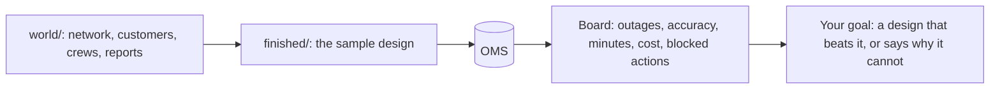

# Meet the desk

## After this part you can

Run the finished storm desk, and say which job needs an agent.

## You leave with

A `first-look.md` file that names the job.

## The problem

Copperbeck Power is a made-up power company. Its storm desk is the team that handles power cuts on a storm night.
On one storm night, the desk gets 4,200 reports. They come as phone calls, texts, web forms and smart meter alarms.

A smart meter is a box at a home. It tells the company when the power is off. The desk has nine crews and nine
critical customers. A crew is a team that goes out and fixes the lines. A critical customer is a place such as a
hospital or a care home.

The operations director wants "an AI agent". Before you design anything, you watch the sample design handle that
night. The sample design is a finished answer that comes with the course, in `finished/`. Its numbers give every
later choice a number to beat.

The OMS is the outage management system. It is the place where Copperbeck keeps the true list of outages. The board
is a short summary of the night. Code builds it from the OMS and the logs, not from what a model said.



For example, after you run `bun run storm`, the board ends with lines like these:

```text
  Outages found                           31 of 31 (+5 false)
  Reports attached to the right outage    92% of 4,200
  Must-never actions blocked              2
  Model cost of the storm night           $0.15
```

So the sample design found all 31 outages for 15 cents. Twice, the system stopped it from doing something it must
never do. Your design has to do at least as well, or explain why it cannot.

| Step                   | Minutes | What the check reads                                                                           |
| ---------------------- | ------- | ---------------------------------------------------------------------------------------------- |
| `meet-the-outage-desk` | 15      | Three fresh replay runs of the finished system (OMS, ledger, events), and your `first-look.md` |

## Steps

| Step                   | What you do                                                       |
| ---------------------- | ----------------------------------------------------------------- |
| `meet-the-outage-desk` | Run `bun run verify meet-the-outage-desk` until every rule passes |

## Watch and read

| Kind  | Title                                        | Who made it                               | Why                                                                   | Link                                                              |
| ----- | -------------------------------------------- | ----------------------------------------- | --------------------------------------------------------------------- | ----------------------------------------------------------------- |
| video | How we build effective agents                | Barry Zhang, Anthropic                    | The maker of the method explains when an agent is worth its cost.     | https://www.youtube.com/watch?v=D7_ipDqhtwk                       |
| read  | Building effective agents                    | Erik Schluntz and Barry Zhang, Anthropic  | Start simple, and add rungs only when you must.                       | https://www.anthropic.com/engineering/building-effective-agents   |
| video | Software is changing again                   | Andrej Karpathy, at a startup school talk | A top researcher explains what models can and cannot do for software. | https://www.youtube.com/watch?v=LCEmiRjPEtQ                       |
| read  | How we built our multi-agent research system | Anthropic engineering                     | The team that runs it shares real token costs and failures.           | https://www.anthropic.com/engineering/multi-agent-research-system |

## Project

Pick one real job from your own work, and say why it might need an agent.

## Walkthrough

First, put the world back to its starting state.

```bash
bun run world reset
```

Expect: `World reset: world/state/oms.db seeded from world/seed/.`

Next, play the storm night. This is a replay. The model replies were saved once, so you need no key, and you pay
nothing.

```bash
bun run storm
```

Expect: `Storm night replayed.`

Last, check your work.

```bash
bun run verify meet-the-outage-desk
```

Expect: `Done. All 8 rules pass.` once `first-look.md` holds the board's numbers.
