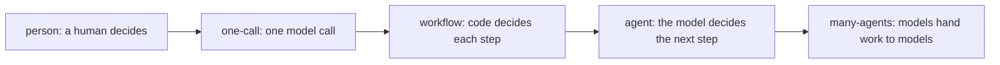

# Place on the ladder

## The problem

Copperbeck's operations director wants "an AI agent for storm nights". If every job on the desk becomes an
agent, the bill grows too. Anthropic measured that an agent uses about 4 times the tokens of a chat. A system
of many agents uses about 15 times
([Anthropic, multi-agent research system](https://www.anthropic.com/engineering/multi-agent-research-system)).
A token is a small piece of text a model reads or writes, and you pay for each one.

Cost is not the only risk. An agent on the switching job would break the desk's first safety rule.



Each level of this ladder is a rung. To place a job on a rung, ask one question: **who decides the next
step?** The answer is a person, code, or the model.

## Your challenge

Open `design.md` in this folder. Find the `## Shape` section. Place each of the desk's four jobs (from
`world/desk.yaml`) on one rung. For each job, fill these fields:

| Field               | Allowed values                                                                |
| ------------------- | ----------------------------------------------------------------------------- |
| `rung`              | `person`, `one-call`, `workflow`, `agent`, `many-agents`                      |
| `decides_next_step` | `person`, `code` or `model`, matching the rung                                |
| `trigger`           | `person`, `event`, `schedule`, `agent`: what starts it                        |
| `lifetime`          | a number and a unit, such as `20 minutes`                                     |
| `reason`            | only on agent rungs: `open-ended-steps`, `varied-input` or `parallel-breadth` |
| `why`               | one sentence that names a fact of the storm desk                              |

For example, here is one job from the sample answer in `../solution/design.md`:

```yaml
- job: group-the-reports
  rung: workflow
  decides_next_step: code
  trigger: event
  lifetime: 5 minutes
  why: Every report follows the same steps (read the address, find the device, attach or open an outage), so code can decide each step.
```

Every report goes through the same steps, so code can choose the next one. That makes it a workflow, not an
agent.

Read `world/policy.md` before you place `switch-the-feeder`.

## Done when

- `design.md` has a Shape section with a `yaml design` block.
- Every job on the desk appears exactly once.
- Every job has a rung, a matching `decides_next_step`, a trigger and a lifetime.
- Every agent job names a reason from the list.
- The job the policy keeps for a person is on the `person` rung.
- At least one machine job is below the agent rung.
- Every `why` has at least 8 words.

```bash
bun run verify place-on-the-ladder
```

Expect: `Done. All 9 rules pass.` and a `Progress:` line.

On the starter, three rules pass and six fail. Each FAIL line tells you what to try next. One of them says:

```text
  FAIL  at least one machine job sits below the agent rung
        Try next: ask of each job: can code decide every next step? If yes, it is a workflow or one model call, not an agent
```

## If you get stuck

| What you see                                              | Fix                                                                                     |
| --------------------------------------------------------- | --------------------------------------------------------------------------------------- |
| `FAIL design.md has a Shape section`                      | Keep the fence line exactly as ` ```yaml design `. Indent with spaces, not tabs.        |
| `FAIL ... matches its rung`                               | A workflow is still decided by code, even when one step calls a model.                  |
| `FAIL ... reserves for a person`                          | Policy rule P1 says no software operates a switch.                                      |
| `FAIL at least one machine job sits below the agent rung` | Ask of each job: could I write every step down before it starts? If yes, it is not an agent. |

To compare with the sample, run `bun run verify place-on-the-ladder solution`. Then read
`../solution/design.md`.

## Words you will use

- **Rung**: one level of the ladder, from a person doing the job to many agents doing it.
- **Workflow**: a fixed recipe in code. A model may do one step, but code picks the next step.
- **Agent**: a loop where the model picks the next step. It calls tools until it decides it is done.
- **Trigger**: what starts a job. It can be a person, an event such as a new report, a schedule, or another
  agent.
- **Lifetime**: how long one run of the job lasts, from start to finish.
