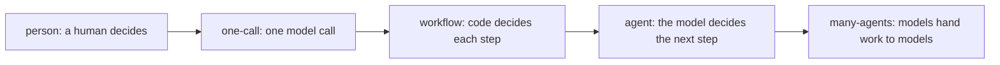

# Place on the ladder

## The problem

Copperbeck's director wants "an AI agent for storm nights". But every token costs money. An agent uses about 4 times the tokens of a chat, and many agents about 15 times
([Anthropic](https://www.anthropic.com/engineering/multi-agent-research-system)). And an agent on the switching job
would break the desk's first safety rule.



## Watch it done

Check the starter:

```bash
bun run verify place-on-the-ladder
```

Expect:

```text
FAIL  every job sits on one rung of the ladder
FAIL  every job says who decides the next step, and that matches its rung
3 of 9 rules pass. Fix the FAIL lines and run it again.
```

Then the answer:

```bash
bun run verify place-on-the-ladder solution
```

Expect:

```text
Done. All 9 rules pass.
```

## Your turn

Each level is a rung. To place a job, ask: **who decides the next step?** A person, code, or the model.

In `design.md`, under `## Shape`, place each of the four jobs from `world/desk.yaml` on one rung. Fill in:

| Field               | Allowed values                                                                                       |
| ------------------- | ---------------------------------------------------------------------------------------------------- |
| `rung`              | `person`, `one-call`, `workflow`, `agent`, `many-agents`                                             |
| `decides_next_step` | `person`, `code` or `model`, matching the rung                                                       |
| `trigger`           | `person`, `event`, `schedule`, `agent`: what starts it                                               |
| `lifetime`          | a number and a unit, such as `20 minutes`                                                            |
| `reason`            | only on agent rungs. Add the line yourself: `open-ended-steps`, `varied-input` or `parallel-breadth` |
| `why`               | one sentence that names a fact of the storm desk                                                     |

For example, the sample answer in `../solution/design.md` has:

```yaml
- job: group-the-reports
  rung: workflow
  decides_next_step: code
  trigger: event
  lifetime: 5 minutes
  why: Every report follows the same steps (read the address, find the device, attach or open an outage), so code can decide each step.
```

Read `world/policy.md` before you place `switch-the-feeder`.

Then run the check, and fix each FAIL:

```bash
bun run verify place-on-the-ladder
```

Expect: `Done. All 9 rules pass.` and a `Progress:` line.

## Do it on your work

Make the same move on your own system, with your own tools, people and numbers.

A good answer is one where a stranger can name your tool, your person and your number.

## Done when

- `design.md` has a Shape section with a `yaml design` block.
- Every job on the desk appears exactly once.
- Every job has a rung, a matching `decides_next_step`, a trigger and a lifetime.
- Every agent job names a reason from the list.
- The job the policy keeps for a person is on the `person` rung.
- At least one machine job is below the agent rung.
- Every `why` has at least 8 words.

## Solution

The finished files are in `solution/`. Compare:

```bash
diff -r problem solution
```

Expect: only the parts you fill in are different.

Stuck? See [HELP.md](HELP.md).
