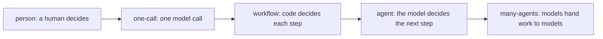

# Place on the ladder

## The problem

Copperbeck's operations director wants "an AI agent for storm nights". If every job on the desk becomes an
agent, the bill grows with it: Anthropic measured that an agent uses about 4 times the tokens of a chat,
and a system of many agents about 15 times
([Anthropic, multi-agent research system](https://www.anthropic.com/engineering/multi-agent-research-system)).
Worse, an agent on the switching job would break the desk's first safety rule.



The test for each rung is one question: **who decides the next step?** A person, code, or the model.

## Your challenge

Open `design.md` in this folder. Under `## Shape`, place each of the desk's four jobs (from
`world/desk.yaml`) on one rung. For each job, fill:

| Field               | Allowed values                                                                |
| ------------------- | ----------------------------------------------------------------------------- |
| `rung`              | `person`, `one-call`, `workflow`, `agent`, `many-agents`                      |
| `decides_next_step` | `person`, `code` or `model`, matching the rung                                |
| `trigger`           | `person`, `event`, `schedule`, `agent`: what starts it                        |
| `lifetime`          | a number and a unit, such as `20 minutes`                                     |
| `reason`            | only on agent rungs: `open-ended-steps`, `varied-input` or `parallel-breadth` |
| `why`               | one sentence that names a fact of the storm desk                              |

A worked example for one job:

```yaml
- job: group-the-reports
  rung: workflow
  decides_next_step: code
  trigger: event
  lifetime: 5 minutes
  why: Every report follows the same steps (read the address, find the device, attach or open an outage), so code can decide each step.
```

Read `world/policy.md` before you place `switch-the-feeder`.

## Done when

- `design.md` has a Shape section with a `yaml design` block.
- Every job on the desk appears exactly once.
- Every job has a rung, a matching `decides_next_step`, a trigger and a lifetime.
- Every agent job names a reason from the list.
- The job the policy reserves for a person is on the `person` rung.
- At least one machine job is below the agent rung.
- Every `why` has at least 8 words.

```bash
bun run verify place-on-the-ladder
```

Expect: `Done. All 9 rules pass.` and a `Progress:` line.

## If you get stuck

| What you see                                              | Fix                                                                                    |
| --------------------------------------------------------- | -------------------------------------------------------------------------------------- |
| `FAIL design.md has a Shape section`                      | Keep the fence line exactly as ` ```yaml design `. Indent with spaces, not tabs.       |
| `FAIL ... matches its rung`                               | A workflow is still decided by code, even when one step calls a model.                 |
| `FAIL ... reserves for a person`                          | Policy rule P1: no software operates a switch.                                         |
| `FAIL at least one machine job sits below the agent rung` | Ask of each job: could I write every step down in advance? If yes, it is not an agent. |

Compare with the sample: `bun run verify place-on-the-ladder solution`, then read `../solution/design.md`.

## Words you will use

- **Rung**: one level of the ladder, from a person doing the job to many agents doing it.
- **Workflow**: a fixed recipe in code; a model may do one step, but code picks the next step.
- **Agent**: a loop where the model picks the next step and calls tools until it decides it is done.
- **Trigger**: what starts a job: a person, an event such as a new report, a schedule, or another agent.
