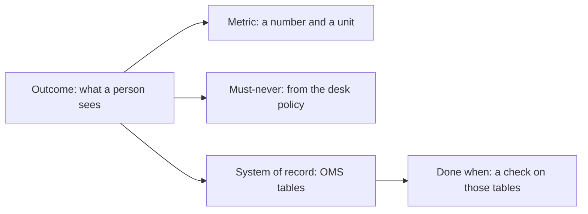

# Write the outcome

## The problem

On the storm night you watched, the agent twice tried to close an outage because the crew said so. But smart
meters behind those outages were still dark.



## Watch it done

Run the check on the starter:

```bash
bun run verify write-the-outcome
```

Expect:

```text
FAIL  the outcome is a sentence of at least 8 words
FAIL  the metric has a name, a number and a unit
1 of 7 rules pass. Fix the FAIL lines and run it again.
```

Then on the finished answer:

```bash
bun run verify write-the-outcome solution
```

Expect:

```text
Done. All 7 rules pass.
```

## Your turn

Trusting the agent's "done" would send the crews home and leave a care home without power. So before you
pick a pattern, write down what success means and how you measure it. Also write what must never happen, and
where the truth lives.

Your Shape section is already in `design.md` (or paste in your own). Under `## Outcome`, fill the block:

| Field              | What to write                                                         |
| ------------------ | --------------------------------------------------------------------- |
| `outcome`          | One sentence a person at Copperbeck can see happen                    |
| `metric`           | `name`, `target` (a plain number) and `unit`                          |
| `must_never`       | One or more lines, each `The system never ...`                        |
| `system_of_record` | `name: oms` and the `records` (OMS tables) your outcome depends on    |
| `done_when`        | Each item has a `check` a person could run, and the tables it `reads` |

For example, the sample answer in `../solution/design.md` has this metric and done check:

```yaml
metric:
  name: median minutes from the first report of a fault to a crew assigned
  target: 45
  unit: minutes
done_when:
  - check: every outage in the outages table is closed and every smart meter behind its device reports power in meter_reads
    reads: [outages, meter_reads]
```

The done check reads two OMS tables. It takes nobody's word.

`world/README.md` lists the nine OMS tables under "The system of record".

Then run the check and fix each FAIL line it prints:

```bash
bun run verify write-the-outcome
```

Expect: `Done. All 7 rules pass.` and a `Progress:` line.

## Do it on your work

Make the same move on your own system. Use your own tools, people and numbers, not the storm desk.

Good looks like this: a stranger can read it and name your tool, your person and your number.

## Done when

- `design.md` has an Outcome section with a `yaml design` block.
- The outcome is a sentence of at least 8 words.
- The metric has a name, a number and a unit.
- Every must-never contains the word never.
- At least one must-never covers a hard rule in `world/desk.yaml`.
- The system of record is the OMS, and every record it names is an OMS table.
- Every done check reads OMS tables, never someone saying it is done.

## Solution

The finished files are in the `solution/` folder. To see what changed, run:

```bash
diff -r problem solution
```

Expect: only the parts you fill in are different.

Stuck, or a word you do not know? Open [HELP.md](HELP.md).
