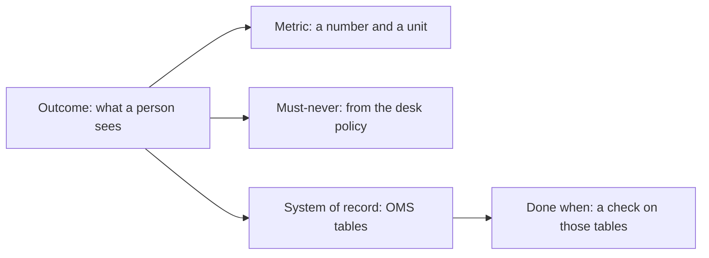

# Write the outcome

## The problem

On the storm night you watched in orientation, the sample design's agent tried to close two outages on the
crew's word while smart meters behind them were still dark. A design that says "done" when the agent says
done would have sent the crews home and left a care home without power. Before you pick a pattern, write
down what success means, how you measure it, what must never happen, and where the truth lives.



## Your challenge

Your Shape section is already in `design.md` (copy in your own from the last step if you prefer it). Under
`## Outcome`, fill the block:

| Field              | What to write                                                         |
| ------------------ | --------------------------------------------------------------------- |
| `outcome`          | One sentence a person at Copperbeck can see happen                    |
| `metric`           | `name`, `target` (a plain number) and `unit`                          |
| `must_never`       | One or more lines, each `The system never ...`                        |
| `system_of_record` | `name: oms` and the `records` (OMS tables) your outcome depends on    |
| `done_when`        | Each item has a `check` a person could run, and the tables it `reads` |

The OMS tables are listed in `world/README.md`. To see them yourself:

```bash
bun run world
```

Expect: `The world is ready. Next: bun run storm`

## Done when

- `design.md` has an Outcome section with a `yaml design` block.
- The outcome is a sentence of at least 8 words.
- The metric has a name, a number and a unit.
- Every must-never contains the word never.
- At least one must-never covers a hard rule in `world/desk.yaml`.
- The system of record is the OMS and every record it names is an OMS table.
- Every done check reads OMS tables and never relies on someone saying it is done.

```bash
bun run verify write-the-outcome
```

Expect: `Done. All 7 rules pass.` and a `Progress:` line.

## If you get stuck

| What you see                                        | Fix                                                                                                                    |
| --------------------------------------------------- | ---------------------------------------------------------------------------------------------------------------------- |
| `FAIL the metric has a name, a number and a unit`   | Write `target: 45`, not `target: 45 minutes`; the unit goes in `unit:`.                                                |
| `FAIL the must-never covers at least one hard rule` | Rules P2 and P3 in `world/policy.md` are the ones a machine could break.                                               |
| `FAIL the system of record is the OMS`              | Name tables that exist, such as `outages`, `meter_reads`, `calls`. A notes file or the agent's memory is not a record. |
| `FAIL done is a check against OMS records`          | Replace "the agent reports it is fixed" with what the meters in `meter_reads` show.                                    |

## Words you will use

- **Outcome**: the change in the world the system exists to make.
- **Metric**: the number that tells you how well the outcome is met.
- **Must-never**: an action the system may never take, whatever the model decides.
- **System of record**: the place the business treats as the truth; here, the OMS.
