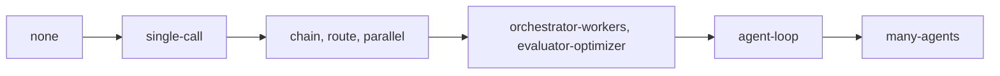

# Pick the pattern

## The problem

A rung says who decides; a pattern says how the work flows. Teams often jump to the most complex pattern
because it demos well. Microsoft's pattern guide lists "Adding agents that don't provide meaningful
specialization" as an antipattern
([Azure Architecture Center, AI agent orchestration patterns](https://github.com/MicrosoftDocs/architecture-center/blob/main/docs/ai-ml/guide/ai-agent-design-patterns.md)).
Each step up costs tokens: about 4 times a chat for one agent, about 15 times for many
([Anthropic](https://www.anthropic.com/engineering/multi-agent-research-system)). Pick the simplest
pattern that works, and say why the next simpler one fails.



## Your challenge

Under `## Pattern` in `design.md`, give each job one pattern that fits its rung in your Shape section:

| Rung          | Patterns that fit                                                           |
| ------------- | --------------------------------------------------------------------------- |
| `person`      | `person`                                                                    |
| `one-call`    | `single-call`                                                               |
| `workflow`    | `chain`, `route`, `parallel`, `orchestrator-workers`, `evaluator-optimizer` |
| `agent`       | `agent-loop`                                                                |
| `many-agents` | `many-agents`                                                               |

For every machine job, add `rejected` (a simpler pattern you considered, or `none` for a single call) and
`why_not_simpler` (the fact of the storm desk that breaks it). For an agent pattern, add `token_multiplier`:
how many times the tokens of a chat you expect it to use.

## Done when

- `design.md` keeps its Shape section and has a Pattern section with a `yaml design` block.
- Every job on the desk has exactly one pattern.
- Every pattern is on the list and fits the job's rung.
- Every machine job names a simpler pattern it rejected.
- Every `why_not_simpler` has at least 10 words.
- Every agent pattern has a `token_multiplier` in the published range.

```bash
bun run verify pick-the-pattern
```

Expect: `Done. All 6 rules pass.` and a `Progress:` line.

## If you get stuck

| What you see                                                 | Fix                                                                           |
| ------------------------------------------------------------ | ----------------------------------------------------------------------------- |
| `FAIL every pattern is on the list and fits the job's rung`  | Change the pattern, or go back and change the rung in Shape. They must agree. |
| `FAIL every machine job names a simpler pattern it rejected` | `rejected` must sit lower on the diagram above than your choice.              |
| `FAIL ... token multiplier`                                  | One agent: 3 to 5. Many agents: 10 to 20.                                     |

## Words you will use

- **Route**: code sends each input down one of several paths, such as meter alarms one way and text another.
- **Chain**: fixed steps in order, each feeding the next.
- **Orchestrator-workers**: one model splits a task and hands parts to other calls.
- **Token multiplier**: how many times more tokens a design uses than a single chat answer.
