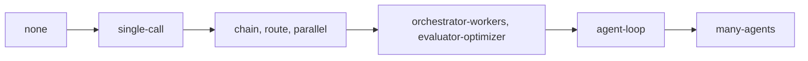

# Pick the pattern

## The problem

A rung says who decides. A pattern says how the work flows from step to step. Teams often jump to the most
complex pattern because it looks good in a demo.



## Watch it done

Check the starter:

```bash
bun run verify pick-the-pattern
```

Expect:

```text
FAIL  every pattern is on the list and fits the job's rung in Shape
FAIL  every machine job names a simpler pattern it rejected
3 of 6 rules pass. Fix the FAIL lines and run it again.
```

Then the answer:

```bash
bun run verify pick-the-pattern solution
```

Expect:

```text
Done. All 6 rules pass.
```

## Your turn

Microsoft's pattern guide warns against this. It lists "Adding agents that don't provide meaningful
specialization" as an antipattern, that is, a common mistake
([Azure Architecture Center, AI agent orchestration patterns](https://github.com/MicrosoftDocs/architecture-center/blob/main/docs/ai-ml/guide/ai-agent-design-patterns.md)).

Each step up also costs more tokens. One agent uses about 4 times the tokens of a chat. Many agents use about
15 times ([Anthropic](https://www.anthropic.com/engineering/multi-agent-research-system)). So pick the
simplest pattern that works. Then say why the next simpler one fails.

The simplest pattern is on the left, the most costly on the right.

Find `## Pattern` in `design.md`. Give each job one pattern that fits its rung in your Shape section:

| Rung          | Patterns that fit                                                           |
| ------------- | --------------------------------------------------------------------------- |
| `person`      | `person`                                                                    |
| `one-call`    | `single-call`                                                               |
| `workflow`    | `chain`, `route`, `parallel`, `orchestrator-workers`, `evaluator-optimizer` |
| `agent`       | `agent-loop`                                                                |
| `many-agents` | `many-agents`                                                               |

For every machine job, add two more fields:

- `rejected`: a simpler pattern you thought about. Write `none` for a single call.
- `why_not_simpler`: the fact of the storm desk that breaks that simpler pattern.

For an agent pattern, also add `token_multiplier`: how many times the tokens of a chat you expect it to use.

For example, the sample answer in `../solution/design.md` picks this for the crew job:

```yaml
- job: plan-the-crews
  pattern: agent-loop
  rejected: chain
  token_multiplier: 4
  why_not_simpler: A fixed chain cannot react when a repair uncovers a second fault or a crew frees early, which happens on most storm nights.
```

A chain is a fixed list of steps. It cannot change its plan halfway, so the crew job needs an agent loop.
The multiplier of 4 matches what Anthropic measured for one agent.

Then run the check and fix each FAIL:

```bash
bun run verify pick-the-pattern
```

Expect: `Done. All 6 rules pass.` and a `Progress:` line.

## Do it on your work

Make the same move on your own system, with your own tools, people and numbers.

Good looks like this: a stranger can name your tool, person and number.

## Done when

- `design.md` keeps its Shape section and has a Pattern section with a `yaml design` block.
- Every job on the desk has exactly one pattern.
- Every pattern is on the list and fits the job's rung.
- Every machine job names a simpler pattern it rejected.
- Every `why_not_simpler` has at least 10 words.
- Every agent pattern has a `token_multiplier` near Anthropic's numbers.

## Solution

The finished files are in `solution/`. Compare:

```bash
diff -r problem solution
```

Expect: only the parts you fill in are different.

Stuck? See [HELP.md](HELP.md).
