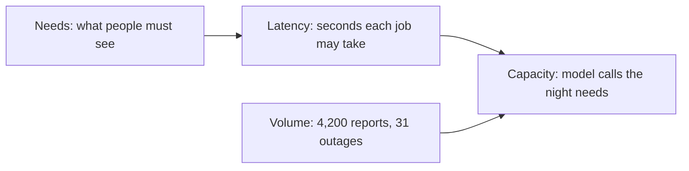

# Size the load

## The problem

On the storm night, 4,200 reports came in for 31 outages. A design that works for ten reports can fall over
at 4,200. So before you build, write down what people need, how fast each job must answer, and how many
model calls the night needs.



## Your challenge

Open `design.md` in this folder. Fill the block under `## Load`:

| Field          | What to write                                                                        |
| -------------- | ------------------------------------------------------------------------------------ |
| `requirements` | At least two sentences about what a customer, a critical customer and a crew need    |
| `load`         | `reports_per_night` and `outages_per_night`, from `storm_night` in `world/desk.yaml` |
| `latency`      | One entry for each job a machine does: a `budget_seconds` number and a `why`         |
| `capacity`     | `reports_needing_model` and `calls_per_night`                                        |

Latency is how long one job may take to answer. A smart meter alarm already names the customer, so it needs
no model. Only phone and text reports do.

For example, one latency entry looks like this:

```yaml
- job: write-the-customer-updates
  budget_seconds: 10
  why: The text should reach the customer while the crew plan is still fresh.
```

The job `switch-the-feeder` belongs to a person, so it gets no budget.

## Done when

- `design.md` has a Load section with a `yaml design` block.
- There are at least two requirements, each a full sentence.
- Every job a machine does has a number of seconds and a reason.
- The load matches the storm night, not the storm month.
- The crew plan has a longer budget than a single call.
- Fewer reports need a model than arrive, and each one gets at least one call.

```bash
bun run verify size-the-load
```

Expect: `Done. All 6 rules pass.` and a `Progress:` line.

## If you get stuck

| What you see                                      | Fix                                                              |
| ------------------------------------------------- | ---------------------------------------------------------------- |
| `FAIL the load is the storm night ...`            | The storm month is 16,000 reports. The night is the smaller one. |
| `FAIL every job a machine does has a latency ...` | Write `budget_seconds: 5`, a bare number with no unit word.      |
| `FAIL the crew plan, a loop of calls ...`         | A loop makes several calls, so it needs the longest budget.      |

## Words you will use

- **Latency**: how long a job takes from start to answer.
- **Capacity**: how much work the system can take in before it slows down.
- **Requirement**: something a person needs the system to do.
