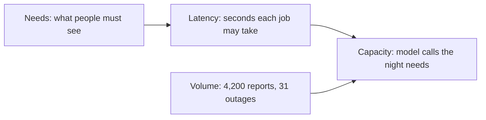

# Size the load for one storm night

## The problem

On the storm night, 4,200 reports came in for 31 outages. A design that works for ten reports can fall over at 4,200. Before you build, write down what people need, how fast each job must answer, and how many model calls the night needs.



## Watch it done

Run the check on the starter:

```bash
bun run verify size-the-load
```

Expect:

```text
FAIL  the load is the storm night in world/desk.yaml, not a storm month
FAIL  the crew plan, a loop of calls, has a longer budget than a single call
1 of 6 rules pass. Fix the FAIL lines and run it again.
```

Then on the finished answer:

```bash
bun run verify size-the-load solution
```

Expect:

```text
Done. All 6 rules pass.
```

## Your turn

Latency is how long one job may take to answer. Capacity is how much work comes in. A smart meter alarm
already names the customer, so it needs no model. Only phone and text reports do.

Open `design.md` in this folder. Fill the block under `## Load`:

1. Write `requirements`: at least two full sentences about what a customer, a critical customer and a crew need.
2. Write `load`: `reports_per_night` and `outages_per_night`, copied from `storm_night` in `world/desk.yaml`.
3. Write one `latency` entry for each job a machine does. Give it a `budget_seconds` number and a `why`.
4. Write `capacity`: `reports_needing_model` and `calls_per_night`.

For example, one latency entry looks like this:

```yaml
- job: write-the-customer-updates
  budget_seconds: 10
  why: The text should reach the customer while the crew plan is still fresh.
```

The job `switch-the-feeder` belongs to a person, so it gets no budget. The crew plan is a loop of calls, so
it gets a longer budget than one call.

Then run the check and fix each FAIL line it prints:

```bash
bun run verify size-the-load
```

Expect: `Done. All 6 rules pass.` and a `Progress:` line.

## Do it on your work

Write the same Load block for your own agent. Use the busiest day you know, its real report count and the slowest job.

Good looks like this: a stranger can read your numbers and say which job is the slowest and why.

## Done when

- `design.md` has a Load section with a `yaml design` block.
- There are at least two requirements, each a full sentence.
- Every job a machine does has a number of seconds and a reason.
- The load matches the storm night, not the storm month.
- The crew plan has a longer budget than a single call.
- Fewer reports need a model than arrive, and each one gets at least one call.

## Solution

The finished files are in the `solution/` folder. To see what changed, run:

```bash
diff -r problem solution
```

Expect: only the parts you fill in are different.

Stuck, or a word you do not know? Open [HELP.md](HELP.md).
