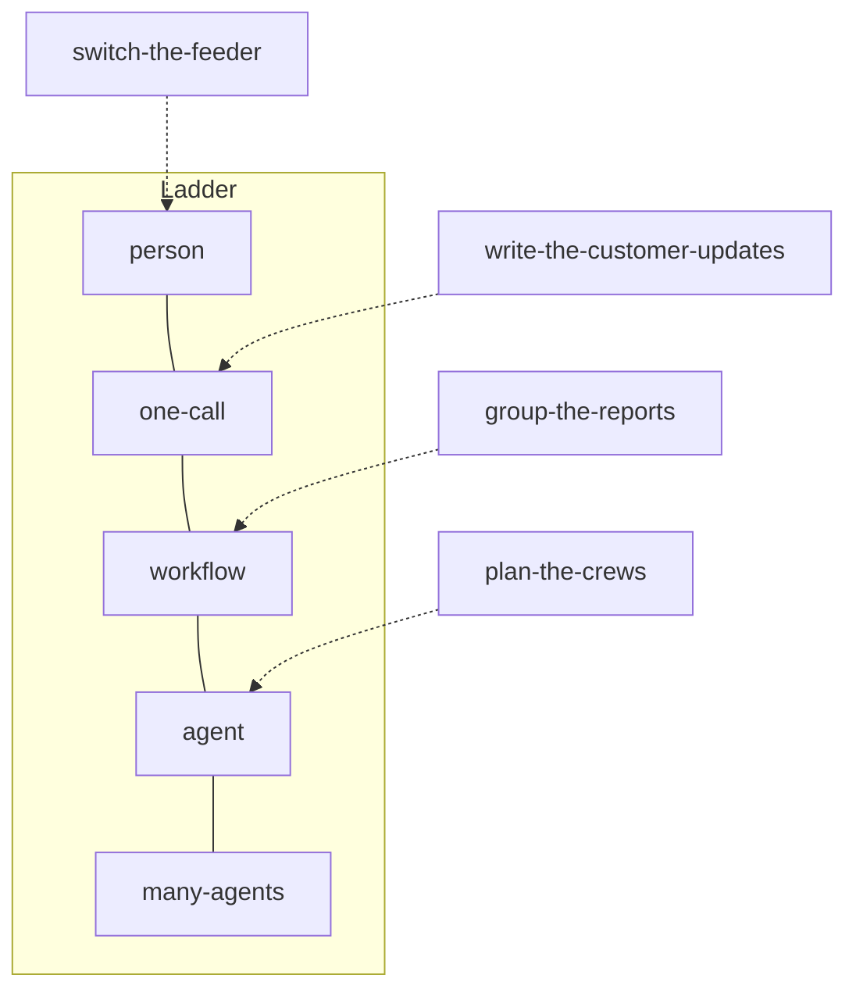

# Choose the shape

## The problem

The operations director asked for "an AI agent for storm nights". Four jobs hide in that wish, and each one
has a different right answer. Choosing the shape is a cost decision: Anthropic found that "agents typically
use about 4x more tokens than chat interactions, and multi-agent systems use about 15x more tokens than
chats" ([How we built our multi-agent research system](https://www.anthropic.com/engineering/multi-agent-research-system),
read 12 Nov 2026). It is also a safety decision: one of the four jobs may never be done by software at all.



The diagram shows where the sample design puts each job. Your design may differ, as long as the checks and
your reasons hold.

| Step | Minutes | You produce | What the check reads |
|---|---|---|---|
| `place-on-the-ladder` | 20 | `## Shape` in `design.md` | Your Shape block, the jobs and policy in `world/desk.yaml` |
| `write-the-outcome` | 20 | `## Outcome` | Your Outcome block, the hard rules in `world/desk.yaml`, the tables of a freshly seeded OMS |
| `pick-the-pattern` | 20 | `## Pattern` | Your Pattern and Shape blocks, the desk's jobs |

Each step's `problem/design.md` starts with the sections from the steps before it, so you can begin at any
step.

## Walkthrough

```bash
bun run verify place-on-the-ladder
```

Expect: `Done. All 9 rules pass.`

```bash
bun run verify write-the-outcome
```

Expect: `Done. All 7 rules pass.`

```bash
bun run verify pick-the-pattern
```

Expect: `Done. All 6 rules pass.`

```bash
bun run verify part choose-the-shape
```

Expect: `Part choose-the-shape is done: 3/3 steps pass.`
