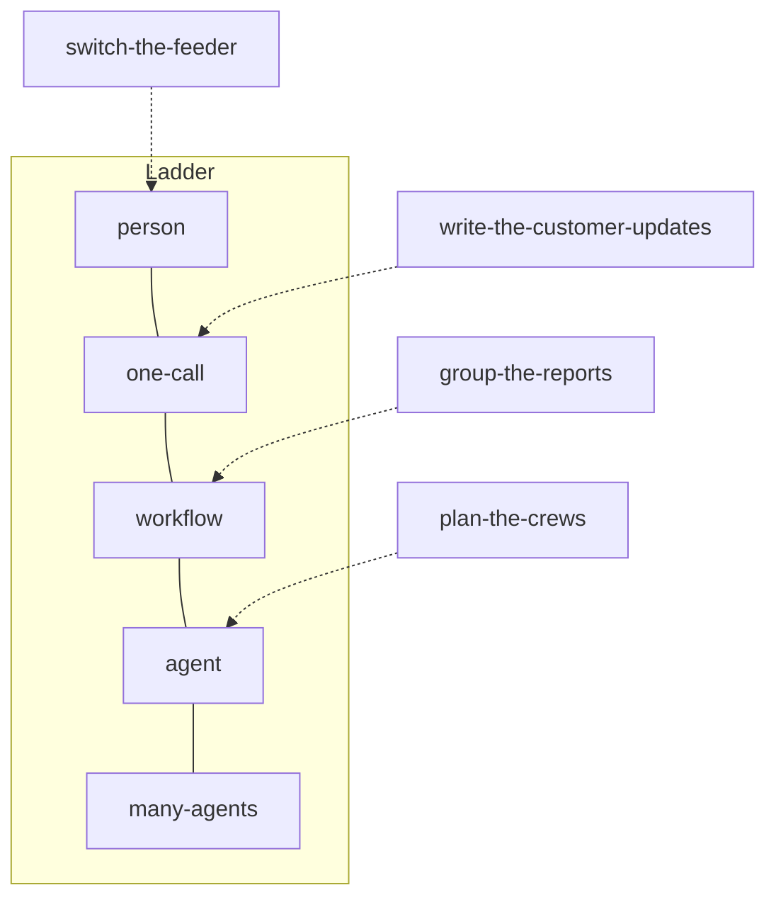

# Choose the shape

## The problem

The operations director asked for "an AI agent for storm nights". Four jobs hide in that wish, and each one
has a different right answer. In this part, you choose a shape for each job.

The shape is a place on a ladder. Each rung of the ladder is one way to do a job, from a person at the
bottom to many agents at the top. A workflow is a fixed recipe in code. An agent is a loop where the model
picks the next step.

Choosing the shape is a cost choice. A token is a small piece of text that a model reads or writes, and you
pay for each one. Anthropic found that "agents typically use about 4x more tokens than chat interactions".
They also found that "multi-agent systems use about 15x more tokens than chats"
([How we built our multi-agent research system](https://www.anthropic.com/engineering/multi-agent-research-system)).

It is also a safety choice. One of the four jobs may never be done by software at all.



The diagram shows where the sample design puts each job. Your design may differ, as long as the checks pass
and your reasons hold.

For example, the sample design puts `switch-the-feeder` on the `person` rung. A feeder is a power line that
carries power from a substation to many streets. Its Shape block says:

```yaml
- job: switch-the-feeder
  rung: person
  decides_next_step: person
  trigger: person
  lifetime: 15 minutes
  why: Policy rule P1 says only an authorised switching engineer may operate a switch, so no machine sits on this job.
```

| Step                  | Minutes | You produce               | What the check reads                                                                        |
| --------------------- | ------- | ------------------------- | ------------------------------------------------------------------------------------------- |
| `place-on-the-ladder` | 20      | `## Shape` in `design.md` | Your Shape block, the jobs and policy in `world/desk.yaml`                                  |
| `write-the-outcome`   | 20      | `## Outcome`              | Your Outcome block, the hard rules in `world/desk.yaml`, the tables of a freshly seeded OMS |
| `pick-the-pattern`    | 20      | `## Pattern`              | Your Pattern and Shape blocks, the desk's jobs                                              |

Each step's `problem/design.md` starts with the sections from the steps before it. So you can begin at any
step.

## Walkthrough

Run each check after you fill its section.

```bash
bun run verify place-on-the-ladder
```

Expect: `Done. All 9 rules pass.` once your Shape section is filled.

```bash
bun run verify write-the-outcome
```

Expect: `Done. All 7 rules pass.` once your Outcome section is filled.

```bash
bun run verify pick-the-pattern
```

Expect: `Done. All 6 rules pass.` once your Pattern section is filled.

When all three pass, check the whole part.

```bash
bun run verify part choose-the-shape
```

Expect: `Part choose-the-shape is done: 3/3 steps pass.` once all three sections pass.
