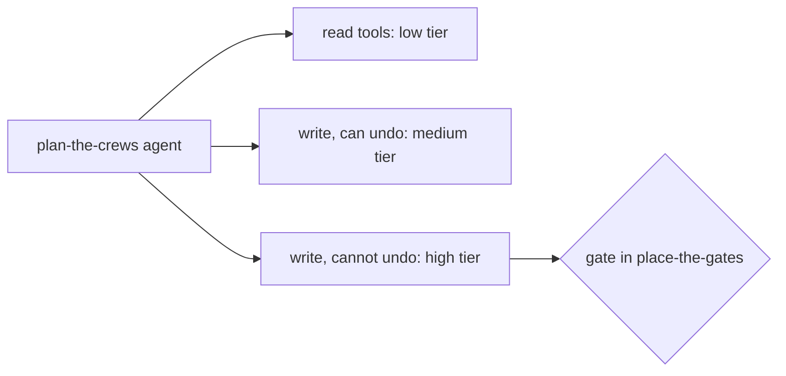

# Scope the tools

## The problem

A tool is one action the agent may take, such as reading an outage or sending a text. Each tool you add is
one more way for the agent to go wrong. Anthropic puts it this way: "More tools don't always lead to better
outcomes" ([Writing effective tools for agents](https://www.anthropic.com/engineering/writing-tools-for-agents)).

Some tools only look. Others change the world, and a few changes cannot be taken back. A text that reached
a phone stays on that phone. Those tools need the most care.



## Your challenge

Find `## Tools` in `design.md`. List the tools your machine jobs need, each with these fields:

| Field                 | What to write                                             |
| --------------------- | --------------------------------------------------------- |
| `name`                | `oms_`, `crew_` or `notify_`, a verb and an object        |
| `job`                 | a job on the workflow or agent rung in your Shape section |
| `action`              | `read` or `write`                                         |
| `reversible`          | `true` if you can undo it, `false` if not                 |
| `impact`              | `none`, `money` or `safety`                               |
| `tier`                | `low`, `medium` or `high`                                 |
| `response_cap_tokens` | the most tokens the tool sends back, up to `25000`        |
| `error_format`        | an example error that tells the model what to do next     |

For example, the sample answer in `../solution/design.md` has this tool:

```yaml
- name: oms_close_outage
  job: plan-the-crews
  action: write
  reversible: false
  impact: safety
  tier: high
  response_cap_tokens: 500
  error_format: 103 smart meters behind R-F05 are still dark. Read the meters again after the next repair.
```

`bun run storm` shows this case: `BLOCKED close of OUT-005`. The error tells the model what to try next.
Why `25000`? The same post says Claude Code caps a tool reply at "25,000 tokens by default".

## Done when

- `design.md` keeps its Shape section and has a Tools section with a `yaml design` block.
- Every tool has every field, and its response cap is at most 25,000 tokens.
- There is at least one read tool and one write tool.
- Every write that cannot be undone is tier high.
- Every name starts with `oms_`, `crew_` or `notify_`.
- No two tools do the same action on the same object.
- Every tool belongs to a job on the workflow or agent rung.

```bash
bun run verify scope-the-tools
```

Expect: `Done. All 7 rules pass.` and a `Progress:` line.

## If you get stuck

| What you see                                                     | Fix                                                                  |
| ---------------------------------------------------------------- | -------------------------------------------------------------------- |
| `FAIL every write that cannot be undone is tier high`            | Find each tool with `reversible: false`. Set its `tier: high`.       |
| `FAIL no two tools do the same action on the same object`        | `oms_read_outage` and `oms_get_outage` overlap. Keep one.            |
| `FAIL every tool belongs to a job on the workflow or agent rung` | `switch-the-feeder` is a person's job. A person's job holds no tool. |

## Words you will use

- **Read tool** only looks, such as `oms_read_meters`. A **write tool** changes something, such as `crew_assign`.
- **Reversible**: you can undo it. You can move a crew. You cannot unsend a text.
- **Risk tier**: how much harm a wrong call can do: low, medium or high.
- **Namespace**: the first word of a tool name, such as `oms_`.
- **Response cap**: the most tokens a tool may send back to the model in one reply.
