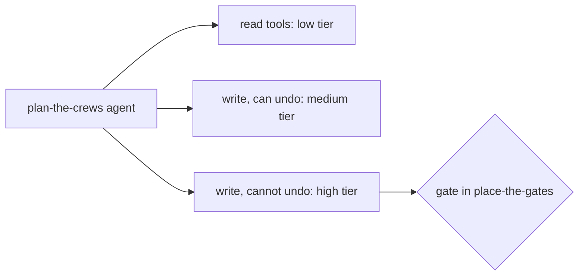

# Scope the tools

## The problem

A tool is one action the agent may take, such as reading an outage or sending a text. Each tool you add is one more
way for the agent to go wrong. Anthropic puts it this way: "More tools don't always lead to better outcomes"
([Writing effective tools for agents](https://www.anthropic.com/engineering/writing-tools-for-agents)).



## Watch it done

Check the starter:

```bash
bun run verify scope-the-tools
```

Expect:

```text
FAIL  every tool has every field, with a response cap of 25,000 tokens or less
FAIL  the agent has at least one read tool and one write tool
3 of 7 rules pass. Fix the FAIL lines and run it again.
```

Then the answer:

```bash
bun run verify scope-the-tools solution
```

Expect:

```text
Done. All 7 rules pass.
```

## Your turn

Some tools only look. Others change the world, and a few changes cannot be taken back. A text that reached a phone
stays on that phone. Those tools need the most care.

Find `## Tools` in `design.md`. List the tools your machine jobs need. Give each one these fields:

| Field                 | What to write                                             |
| --------------------- | --------------------------------------------------------- |
| `name`                | `oms_`, `crew_` or `notify_`, a verb and an object        |
| `job`                 | a job on the workflow or agent rung in your Shape section |
| `action`              | `read` or `write`                                         |
| `reversible`          | `true` if you can undo it, `false` if not                 |
| `impact`              | `none`, `money` or `safety`                               |
| `tier`                | `low`, `medium` or `high`                                 |
| `response_cap_tokens` | the most tokens the tool sends back, up to `25000`        |
| `error_format`        | an example error that tells the model what to do next     |

For example, the sample answer in `../solution/design.md` has this tool:

```yaml
- name: oms_close_outage
  job: plan-the-crews
  action: write
  reversible: false
  impact: safety
  tier: high
  response_cap_tokens: 500
  error_format: 103 smart meters behind R-F05 are still dark. Read the meters again after the next repair.
```

`bun run storm` shows this case: a blocked close of OUT-005. The error tells the model what to try next. Why `25000`?
The same post says Claude Code caps a tool reply at "25,000 tokens by default".

Then run the check, and fix each FAIL:

```bash
bun run verify scope-the-tools
```

Expect: `Done. All 7 rules pass.` and a `Progress:` line.

## Do it on your work

Make the same move on your own system, with your own tools, people and numbers.

A good answer is one where a stranger can name your tool, your person and your number.

## Done when

- `design.md` keeps its Shape section, and has a Tools section with a `yaml design` block.
- Every tool has every field, and its response cap is at most 25,000 tokens.
- There is at least one read tool and one write tool.
- Every write that cannot be undone is tier high.
- Every name starts with `oms_`, `crew_` or `notify_`.
- No two tools do the same action on the same object.
- Every tool belongs to a job on the workflow or agent rung.

## Solution

The finished files are in `solution/`. Compare:

```bash
diff -r problem solution
```

Expect: only the parts you fill in are different.

Stuck? See [HELP.md](HELP.md).
