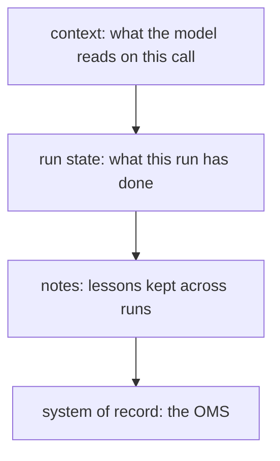

# Map the memory

## The problem

An agent forgets everything between calls. So the harness decides what it remembers, and where. A fact
kept in two places soon says two different things.

Anthropic tested this. Several agents wrote to one shared page about a set of contracts. Only "41 of the 57
facts (72%)" made it into the brief. With one page per contract, all 57 did
([The components of agent memory](https://www.anthropic.com/research/components-of-agent-memory)).

At Copperbeck the OMS already holds the truth about outages, crews and customers. A second list of outages
would drift away from it during a storm.



The top layer lasts one call. The bottom layer lasts for good.

## Your challenge

Find `## Memory` in `design.md`. List every fact the system keeps. Give each fact:

- `fact`: a short name, named after its record or object, such as `outages` or `crews and when each is free`.
- `layer`: `context`, `run-state`, `notes` or `system-of-record`.
- `writer` and `reader`: the job, tool or person that writes it and reads it.
- `expires`: when it goes away, such as `at the end of the run`.

Cover every record in your Outcome and every object your tools act on. For example, `oms_read_meters` acts
on `meter`, and `crew_assign` on `crew`.

Then set `context_cap_tokens`: the most tokens the harness puts in front of the model on one call.

For example, the sample answer in `../solution/design.md` keeps this run-state fact:

```yaml
- fact: the crews this run has sent, keyed outage:crew
  layer: run-state
  writer: crew_assign
  reader: plan-the-crews
  expires: at the end of the run
```

In `bun run storm`, find `CREW-5 to OUT-005`. If the run stops there, this fact tells the restart that
`CREW-5` is already on its way.

## Done when

- `design.md` has Outcome, Tools and Memory sections, each with a `yaml design` block.
- Every fact has a layer from the list, a writer, a reader and an expiry.
- Every record in Outcome and every tool object has a fact.
- No long-term note holds a record the OMS owns.
- Every long-term note has a writer and a reader that are jobs or tools in your design.
- `context_cap_tokens` is set, and it is at least your largest tool response cap.

```bash
bun run verify map-the-memory
```

Expect: `Done. All 6 rules pass.` and a `Progress:` line.

## If you get stuck

| What you see                                          | Fix                                                                    |
| ----------------------------------------------------- | ---------------------------------------------------------------------- |
| `FAIL every record in Outcome and every object ...`   | Add a fact named after the missing record, such as `calls`.            |
| `FAIL no long-term note holds a record the OMS owns`  | Move that fact to `system-of-record`. The OMS is the one place for it. |
| `FAIL every long-term note has a writer and a reader` | Name a job such as `plan-the-crews` as the reader.                     |

## Words you will use

- **Context**: the text the model reads on one call. It is gone after the call.
- **Run state**: what one run has done so far, kept where a restart can read it.
- **Notes**: lessons kept across runs, such as how long fuse repairs took on past storms.
- **System of record**: the one place that holds the truth. At Copperbeck it is the OMS.
- **Two sources of truth**: one fact kept in two places.
