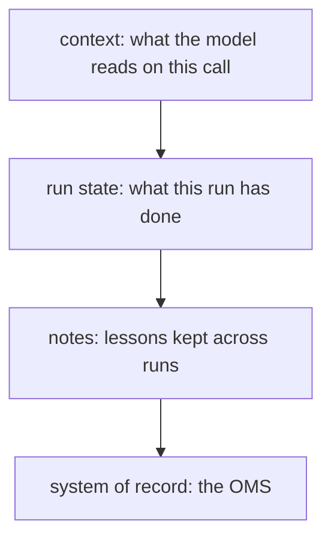

# Map the memory

## The problem

An agent forgets everything between calls. So the harness decides what it remembers, and where. A fact
kept in two places soon says two different things.



## Watch it done

Run the check on the starter:

```bash
bun run verify map-the-memory
```

Expect:

```text
FAIL  every fact has a layer from the list, a writer, a reader and an expiry
FAIL  every record in Outcome and every object a tool acts on has a layer
3 of 6 rules pass. Fix the FAIL lines and run it again.
```

Then on the finished answer:

```bash
bun run verify map-the-memory solution
```

Expect:

```text
Done. All 6 rules pass.
```

## Your turn

Anthropic tested this. Several agents wrote to one shared page about a set of contracts. Only "41 of the 57
facts (72%)" made it into the brief. With one page per contract, all 57 did
([The components of agent memory](https://www.anthropic.com/research/components-of-agent-memory)).

At Copperbeck the OMS already holds the truth about outages, crews and customers. A second list of outages
would drift away from it during a storm.

The top layer lasts one call. The bottom layer lasts for good.

Find `## Memory` in `design.md`. List every fact the system keeps. Give each fact:

- `fact`: a short name, named after its record or object, such as `outages` or `crews`.
- `layer`: `context`, `run-state`, `notes` or `system-of-record`.
- `writer` and `reader`: the job, tool or person that writes it and reads it.
- `expires`: when it goes away, such as the end of the run.

Cover every record in your Outcome and every object your tools act on. For example, `oms_read_meters` acts
on `meter`, and `crew_assign` on `crew`.

Then set `context_cap_tokens`: the most tokens the harness puts in front of the model on one call.

For example, the sample answer in `../solution/design.md` keeps this run-state fact:

```yaml
- fact: the crews this run has sent, keyed outage:crew
  layer: run-state
  writer: crew_assign
  reader: plan-the-crews
  expires: at the end of the run
```

In `bun run storm`, find the line that sends CREW-5 to OUT-005. If the run stops there, this fact tells the restart that
`CREW-5` is already on its way.

Then run the check and fix each FAIL line it prints:

```bash
bun run verify map-the-memory
```

Expect: `Done. All 6 rules pass.` and a `Progress:` line.

## Do it on your work

Make the same move on your own system. Use your own tools, people and numbers, not the storm desk.

Good looks like this: a stranger can read it and name your tool, your person and your number.

## Done when

- `design.md` has Outcome, Tools and Memory sections, each with a `yaml design` block.
- Every fact has a layer from the list, a writer, a reader and an expiry.
- Every record in Outcome and every tool object has a fact.
- No long-term note holds a record the OMS owns.
- Every long-term note has a writer and a reader that are jobs or tools in your design.
- `context_cap_tokens` is set, and it is at least your largest tool response cap.

## Solution

The finished files are in the `solution/` folder. To see what changed, run:

```bash
diff -r problem solution
```

Expect: only the parts you fill in are different.

Stuck, or a word you do not know? Open [HELP.md](HELP.md).
