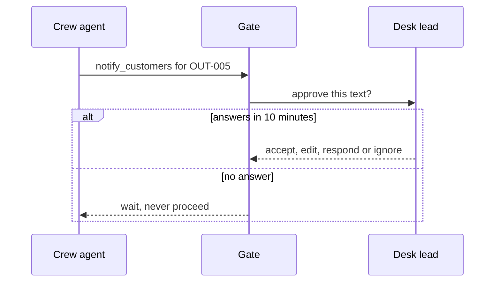

# Place the gates

## The problem

A gate is a stop where a person must say yes before an action runs. A gate only works if the person reads
what they approve.

Anthropic found that people "accept 93%" of the permission prompts Claude Code shows them
([Claude Code auto mode](https://www.anthropic.com/engineering/claude-code-auto-mode)). People click yes
when they see too many prompts. So a gate people click through is not a gate.

On a storm night the desk lead is tired and busy. Every gate you add takes some of their attention.



## Your challenge

Find `## Gates` in `design.md`. Add one gate for every tier-high tool, and one for rule P3 in
`world/policy.md`. Give each gate:

- `gate`: a short name. `tools`: the tools it stops, from your Tools section.
- `trigger`: what makes it fire. `decides`: the person who answers, such as `desk-lead`.
- `answers`: some of `accept`, `edit`, `respond` and `ignore`.
- `deadline_minutes` and `on_timeout`: `wait`, `escalate` or `cancel`. Never `proceed`.
- `per` and `count`: it fires `count` times per `outage`, `report` or `critical-call`.

Then set `limit_per_shift`: the most gates one desk lead can read well in one shift.

The check counts the gates for you. It takes the storm month in `world/desk.yaml` (`420` outages, `16000`
reports, `260` critical calls). It spreads them over the shifts in a month of `480`-minute shifts. That is
90 shifts: 30 days of three shifts a day.

For example, the sample answer in `../solution/design.md` has two gates per outage and one per critical
call:

```text
(420 + 420 + 260) gates / 90 shifts = about 12 gates per shift
```

One gate per report instead would give `16000 / 90`, about 178 gates per shift. Nobody reads that many.

## Done when

- `design.md` has Tools and Gates sections, each with a `yaml design` block.
- Every gate names its tools, trigger, the person who decides, answers and deadline.
- Every tier-high tool has a gate.
- No gate proceeds on timeout.
- Gates per desk lead per shift stay under your `limit_per_shift`, which is at most 240.
- A gate's trigger names critical customers, such as a hospital or care home.

```bash
bun run verify place-the-gates
```

Expect: `Done. All 6 rules pass.` and a `Progress:` line.

## If you get stuck

| What you see                             | Fix                                                             |
| ---------------------------------------- | --------------------------------------------------------------- |
| `FAIL every tier-high tool has a gate`   | Add the tool's name to a gate's `tools:` list.                  |
| `FAIL no gate proceeds on timeout ...`   | Set `on_timeout: wait`. A storm desk can wait ten more minutes. |
| `FAIL gates per desk lead per shift ...` | Fire the gate per `outage`, not per `report`.                   |
| `FAIL a gate covers rule P3 ...`         | Add a gate whose trigger says "a critical customer ...".        |

## Words you will use

- **Gate**: a stop where a person must answer before the action runs.
- **Trigger**: the event that makes a gate fire.
- **Timeout**: what happens when nobody answers before the deadline.
- **Escalate**: pass the gate to the next person up, such as the duty manager.
- **Approval fatigue**: people stop reading prompts when they see too many, and click yes.
