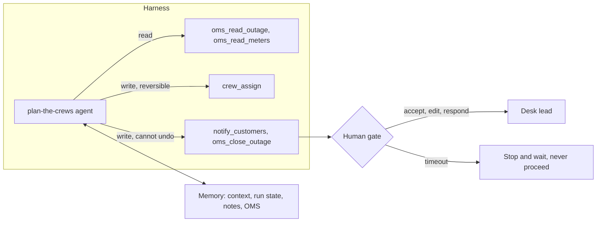

# Design the agent

Status: planned. A part session builds the step folders from [PARTS.md](../../PARTS.md).

## The problem

An agent is a model that picks its own next step and calls tools until the job is done. A tool is one action
the agent may take, such as reading an outage or sending a text. In your design, the crew plan agent can
assign crews, send texts and close outages.

Every tool is a new way to be wrong, and to be wrong fast. So some tools need a gate. A gate is a stop where a
person must say yes before the action runs.

A gate only helps if people read what they approve. Anthropic reports that people "accept 93%" of the
permission prompts Claude Code shows them
([Claude Code auto mode](https://www.anthropic.com/engineering/claude-code-auto-mode)). Picture a tired desk
lead on a storm night. If they click yes without reading, the gate does not protect anyone.

For example, run `bun run storm` and look at this line on the board:
`+295 min  BLOCKED close of OUT-005: 103 meters behind R-F05 still dark`. The agent called `oms_close_outage` to close an outage, and the harness blocked it.
Policy rule P2 says you close an outage only when every smart meter behind it reports power. A close
cannot be undone, so this is the kind of tool that needs a hard stop.

The board shows a second case. At `+60 min`, the Ellerby House care home is "routed to the desk lead, who
calls at + 72 min". Rule P3 says a critical customer hears its restore time from a person. That is a gate
too.

In this part you decide three things: which tools the agent holds, where each fact lives, and where a person
must decide.

The diagram shows the harness, that is, the code around the model that runs its tools. The OMS is the
outage management system, the database that holds the truth about every outage.



Read the arrows from left to right. Read tools only look. Write tools change something. Some writes you can
undo, like moving a crew. Others you cannot, like a text that has already reached a phone. Those go through
the human gate, and if nobody answers in time, the system stops and waits.

| Step              | Minutes | You produce                                                                                |
| ----------------- | ------- | ------------------------------------------------------------------------------------------ |
| `scope-the-tools` | 20      | `## Tools`: each tool with read or write, reversible or not, risk tier, response size cap  |
| `map-the-memory`  | 20      | `## Memory`: each fact, its layer, who writes it, who reads it, when it expires            |
| `place-the-gates` | 20      | `## Gates`: each gate, its trigger, who decides, the answers, the timeout, gates per shift |

A few words from the table. A risk tier is how much harm a wrong call can do. A write you cannot undo is always tier high. A
response size cap is the most text a tool may send back to the model. A memory layer is where a fact is kept.
It may sit in the context (what the model reads on this call), in run state (notes the harness keeps for one
run), in long-term notes, or in the OMS.

Gates per shift matters because people get tired. Your desk lead works a shift of `480` minutes. In a storm
month, the desk handles `420` outages. If every outage asks for several approvals, the lead stops reading
them.

## Walkthrough

TODO(part session): write the walkthrough once the steps exist.

```bash
bun run verify scope-the-tools
```

Expect: TODO(part session)

```bash
bun run verify map-the-memory
```

Expect: TODO(part session)

```bash
bun run verify place-the-gates
```

Expect: TODO(part session)
