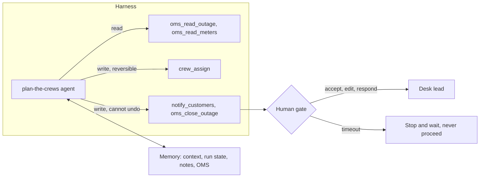

# Design the agent

Status: planned. A part session builds the step folders from [PARTS.md](../../PARTS.md).

## The problem

The crew plan agent can assign crews, send texts and close outages. Every tool it holds is a way to be wrong
at speed, and a human gate only helps if people read what they approve. Anthropic reports that people
"accept 93%" of the permission prompts Claude Code shows them anyway
([Claude Code auto mode](https://www.anthropic.com/engineering/claude-code-auto-mode), 25 Mar 2026, read
12 Nov 2026). A gate that a tired desk lead clicks through on a storm night is not a gate.



| Step | Minutes | You produce |
|---|---|---|
| `scope-the-tools` | 20 | `## Tools`: each tool with read or write, reversible or not, risk tier, response size cap |
| `map-the-memory` | 20 | `## Memory`: each fact, its layer, who writes it, who reads it, when it expires |
| `place-the-gates` | 20 | `## Gates`: each gate, its trigger, who decides, the answers, the timeout, gates per shift |

## Walkthrough

TODO(part session): write the walkthrough once the steps exist.

```bash
bun run verify scope-the-tools
```

Expect: TODO(part session)

```bash
bun run verify map-the-memory
```

Expect: TODO(part session)

```bash
bun run verify place-the-gates
```

Expect: TODO(part session)
