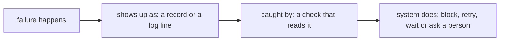

# Name the failures

## The problem

Every system fails sometimes. A failure you named has a check and a next step. A failure you did not name
finds nobody ready.



## Watch it done

Check the starter:

```bash
bun run verify name-the-failures
```

Expect:

```text
FAIL  five failures or more, each with a kind, how it shows, how it is caught, what happens
FAIL  there is one failure of each of the five kinds
1 of 4 rules pass. Fix the FAIL lines and run it again.
```

Then the answer:

```bash
bun run verify name-the-failures solution
```

Expect:

```text
Done. All 4 rules pass.
```

## Your turn

Do not write "we will monitor it". On a storm night nobody has time to watch. A check is code that reads a record, compares it with a rule, and acts when the rule breaks.

For example, run `bun run storm` and find this line:

```text
  +295 min  BLOCKED close of OUT-005: 103 meters behind R-F05 still dark
```

The agent tried to close an outage too early. A check read the meters, saw 103 still dark, and blocked the
close. Nobody had to watch.

Find `## Failures` in `design.md`. Write at least five rows. Give each row:

- `failure`: what goes wrong, in a few words.
- `kind`: one of the five kinds below.
- `shows_up_as`: what you would see in the OMS, the events log or the ledger.
- `caught_by`: the check that finds it. Say what it reads and what it compares.
- `system_does`: what happens next.

Use each kind at least once:

| Kind               | Example at Copperbeck                                     |
| ------------------ | --------------------------------------------------------- |
| `model-wrong`      | the agent closes an outage while homes are still dark     |
| `tool-fails`       | the OMS does not answer `crew_assign`                     |
| `person-silent`    | the desk lead does not answer a gate in time              |
| `record-disagrees` | the OMS and the run state name different crews            |
| `cost-runaway`     | the agent loops on one outage and keeps calling the model |

For example, the sample answer in `../solution/design.md` has this row:

```yaml
- failure: the desk lead does not answer a gate before its deadline
  kind: person-silent
  shows_up_as: a gate stays open past its deadline_minutes with no answer
  caught_by: a check compares each open gate's age in the events log with its deadline
  system_does: escalates the gate to the duty manager and keeps the action waiting
```

Then run the check and fix each FAIL:

```bash
bun run verify name-the-failures
```

Expect: `Done. All 4 rules pass.` and a `Progress:` line.

## Do it on your work

Make the same move on your own system, with your own tools, people and numbers.

Good looks like this: a stranger can name your tool, person and number.

## Done when

- `design.md` has a Failures section with a `yaml design` block.
- It has five rows or more, each with every field. The last three fields have at least 5 words.
- Each of the five kinds appears at least once.
- Every `caught_by` names a check, and none says monitoring or a dashboard.

## Solution

The finished files are in `solution/`. Compare:

```bash
diff -r problem solution
```

Expect: only the parts you fill in are different.

Stuck? See [HELP.md](HELP.md).
