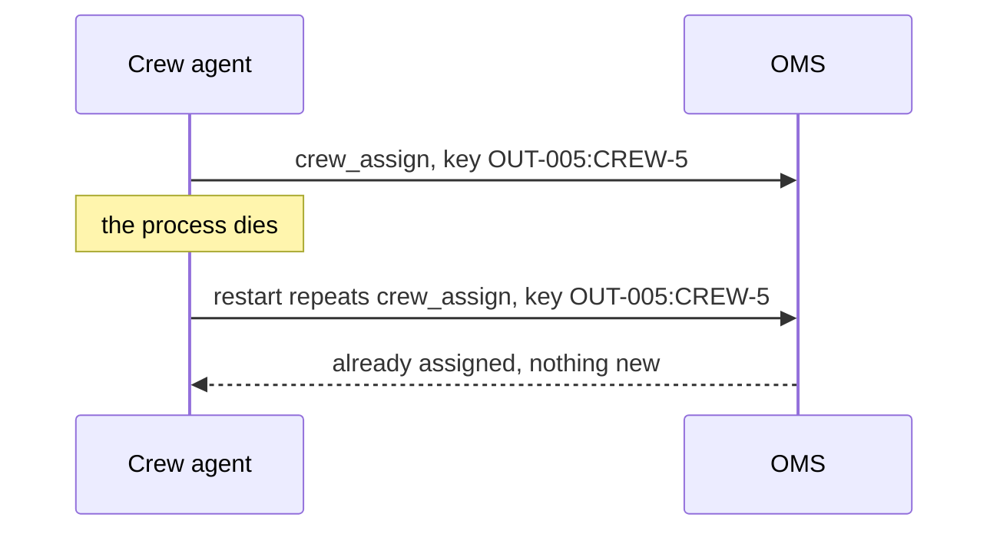

# Design the restart

## The problem

The process that runs the crew agent will die one night. A server restarts, or the code crashes. When it starts again,
it must pick up where it stopped. It must not send a second crew to the same outage.



## Watch it done

Check the starter:

```bash
bun run verify design-the-restart
```

Expect:

```text
FAIL  run state lives outside the process, and the restart says how it resumes
FAIL  every write tool in Tools has an idempotency key
1 of 5 rules pass. Fix the FAIL lines and run it again.
```

Then the answer:

```bash
bun run verify design-the-restart solution
```

Expect:

```text
Done. All 5 rules pass.
```

## Your turn

Anthropic built its managed agents this way. The run's record sits outside the process. So "nothing in the harness
needs to survive a crash" ([Scaling Managed Agents](https://www.anthropic.com/engineering/managed-agents)).

Two ideas make a safe restart:

1. **Run state lives outside the process.** If it lives in memory, it dies with the process.
2. **Every write has an idempotency key.** The key is built from the write's own fields. A repeated write with the
   same key changes nothing.

Find `## Restart` in `design.md`. Fill in three parts:

- `run_state`: `lives_in` is where the run's record sits: `oms`, `database`, `append-only-log`, `durable-workflow` or
  `file`. `resume` says what a fresh process reads first.
- `idempotency`: one entry for every write tool in your Tools section, with its `key`.
- `budget`: `steps_per_run`, `dollars_per_run`, and `when_hit: stop-and-ask`.

The starter fills one key for you. The sample harness already uses it:

```yaml
- tool: crew_assign
  key: outage:crew
```

For example, run `bun run storm` and find the line that sends CREW-5 to OUT-005. The key for that write is
`OUT-005:CREW-5`. If the restart repeats it, the OMS sees the same key and does nothing.

A key must never hold a clock time or a random id. Those change on every try, so a repeat looks new.

The budget stops a run that goes wrong. A run that loops spends money and time. After `40` steps or `$0.50`, the sample
design stops and asks the desk lead.

Then run the check, and fix each FAIL:

```bash
bun run verify design-the-restart
```

Expect: `Done. All 5 rules pass.` and a `Progress:` line.

## Do it on your work

Make the same move on your own system, with your own tools, people and numbers.

A good answer is one where a stranger can name your tool, your person and your number.

## Done when

- `design.md` has Tools and Restart sections, each with a `yaml design` block.
- Run state lives outside the process, and `resume` is filled.
- Every write tool in Tools has an idempotency key.
- Every key is made of field names joined by `:`, with no time or random part.
- The budget has steps and dollars above 0, and `when_hit: stop-and-ask`.

## Solution

The finished files are in `solution/`. Compare:

```bash
diff -r problem solution
```

Expect: only the parts you fill in are different.

Stuck? See [HELP.md](HELP.md).
