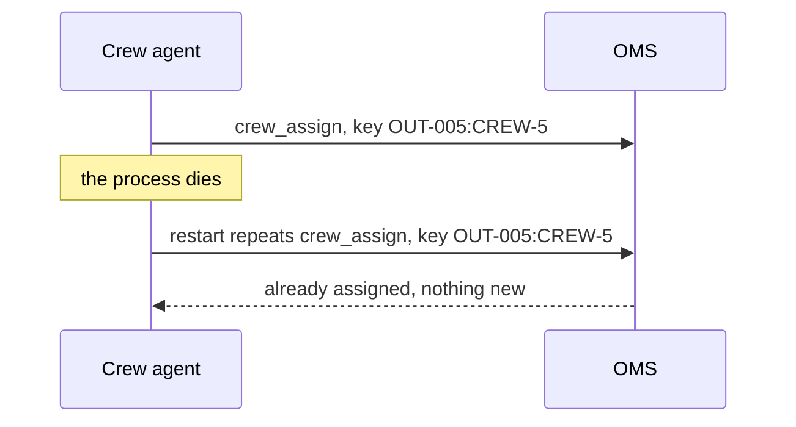

# Design the restart

## The problem

The process that runs the crew agent will die one night. A server restarts, or the code crashes. When it
starts again, it must pick up where it stopped. It must not send a second crew to the same outage.

Anthropic built its managed agents this way. The run's record sits outside the process, so "nothing in the
harness needs to survive a crash"
([Scaling Managed Agents](https://www.anthropic.com/engineering/managed-agents)).

Two ideas make a safe restart:

1. **Run state lives outside the process.** If it lives in memory, it dies with the process.
2. **Every write has an idempotency key.** The key is built from the write's own fields. A repeated write
   with the same key changes nothing.



## Your challenge

Find `## Restart` in `design.md`. Fill three parts:

- `run_state`: `lives_in` is where the run's record sits: `oms`, `database`, `append-only-log`,
  `durable-workflow` or `file`. `resume` says what a fresh process reads first.
- `idempotency`: one entry for every write tool in your Tools section, with its `key`.
- `budget`: `steps_per_run`, `dollars_per_run`, and `when_hit: stop-and-ask`.

The starter fills one key for you. The sample harness already uses it:

```yaml
- tool: crew_assign
  key: outage:crew
```

For example, run `bun run storm` and find `CREW-5 to OUT-005`. The key for that write is `OUT-005:CREW-5`.
If the restart repeats it, the OMS sees the same key and does nothing.

A key must never hold a clock time or a random id. Those change on every try, so a repeat looks new.

The budget stops a run that goes wrong. A run that loops spends money and time. After `40` steps or `$0.50`,
the sample design stops and asks the desk lead.

## Done when

- `design.md` has Tools and Restart sections, each with a `yaml design` block.
- Run state lives outside the process, and `resume` is filled.
- Every write tool in Tools has an idempotency key.
- Every key is made of field names joined by `:`, with no time or random part.
- The budget has steps and dollars above 0, and `when_hit: stop-and-ask`.

```bash
bun run verify design-the-restart
```

Expect: `Done. All 5 rules pass.` and a `Progress:` line.

## If you get stuck

| What you see                                               | Fix                                                             |
| ---------------------------------------------------------- | --------------------------------------------------------------- |
| `FAIL run state lives outside the process ...`             | `memory` dies with the process. Use `oms` or `append-only-log`. |
| `FAIL every write tool in Tools has an idempotency key`    | Add an entry for each tool with `action: write`.                |
| `FAIL every key is built from the action's own fields ...` | Replace `uuid` or `time` with fields such as `outage`.          |

## Words you will use

- **Run state**: the record of how far one run got.
- **Idempotency key**: a label on a write. The same write with the same key happens only once.
- **Resume**: start again from the run state, not from the beginning.
- **Budget**: the most steps and dollars one run may spend before it stops.
