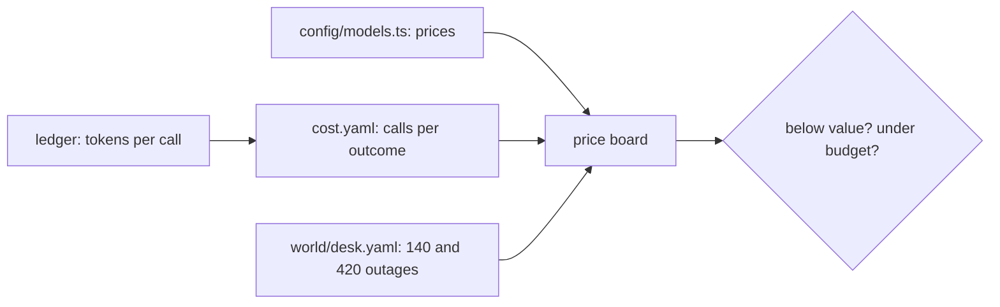
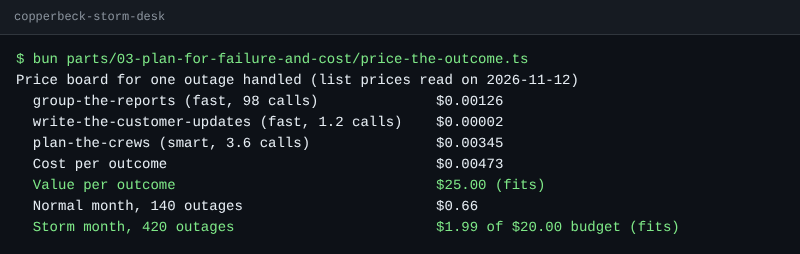

# Price the outcome

## The problem

Finance asks one question: what does a storm night cost? "Tokens" is not an answer they can use. They need
the cost per outcome: what you spend to get one useful result, here one outage handled.

Freedom Forever, the largest home solar installer in the United States, gives its number this way. Each run
of its permit email agent "costs $0.20–$0.35", which it calls "two to five times less than the human
equivalent" ([Freedom Forever customer story](https://claude.com/customers/freedom-forever)). That is a
vendor claim, but it is the right shape: a cost per outcome next to a value per outcome.



## Your challenge

Fill `cost.yaml` next to `design.md`:

- `outcome`: the result you pay for, such as `one outage handled`.
- `value_per_outcome_usd`: what one outcome is worth to Copperbeck, with your reason in a comment.
- `monthly_budget_usd`: what finance will spend on model calls in a month.
- `calls`: one entry for each machine job in your Shape section, with `job`, `role` (`fast` or `smart`),
  `calls_per_outcome`, `input_tokens`, `cached_input_tokens` and `output_tokens`.

Take the tokens from the storm night. Run `bun run storm`, then read `world/state/ledger.jsonl`. Each line
is one model call. For example, this is one crew agent call:

```text
{"purpose":"plan-the-crews","role":"smart","input":6320,"cached":6233,"output":16, ...}
```

The night had 113 such calls for 31 outages. So `calls_per_outcome` is about `3.6`. The starter already
fills the `group-the-reports` call.

Then print the board:

```bash
bun parts/03-plan-for-failure-and-cost/price-the-outcome.ts
```

Expect: `Price board for one outage handled` and a line for each call, once `cost.yaml` is filled.

The sample answer prints this board:



## Done when

- `cost.yaml` has an outcome, a value per outcome, a monthly budget and calls.
- Every call names a job on the desk, a priced role and its tokens.
- Every job on a machine rung in Shape has a call.
- The cost per outcome is below the value per outcome.
- The storm month (`420` outages) stays under the monthly budget.
- The cost per outcome is within four times of what the finished system really spends.

```bash
bun run verify price-the-outcome
```

Expect: `Done. All 6 rules pass.` and a `Progress:` line.

## If you get stuck

| What you see                                              | Fix                                                               |
| --------------------------------------------------------- | ----------------------------------------------------------------- |
| `FAIL every job on a machine rung in Shape has a call`    | Add a call for `plan-the-crews` and `write-the-customer-updates`. |
| `FAIL ... within four times ...`                          | Count calls per outage, not per storm or per call.                |
| `FAIL the storm month ... stays under the monthly budget` | Raise the budget, or cut calls.                                   |

## Words you will use

- **Cost per outcome**: what you spend on model calls for one useful result.
- **Cached input**: input the model read before. It costs about a tenth of fresh input.
- **Role**: `fast` or `smart`. `config/models.ts` maps each role to a model and a price.
- **Value per outcome**: what one result is worth, such as desk time saved.
