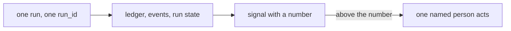

# Design the observability

## The problem

A failure you cannot see, you cannot fix. On a storm night the system runs for hours with nobody watching
each line. You decide ahead of time what it writes down, and who hears about it.



## Watch it done

Run the check on the starter:

```bash
bun run verify design-the-observability
```

Expect:

```text
FAIL  one id ties every record of a run together
FAIL  every failure in design.md has a signal
1 of 5 rules pass. Fix the FAIL lines and run it again.
```

Then on the finished answer:

```bash
bun run verify design-the-observability solution
```

Expect:

```text
Done. All 5 rules pass.
```

## Your turn

Observability means the system writes enough records that you can ask it why something happened. The
records are the signals. A signal with no number and no person is only a log.

Open `observability.md`. The `design.md` next to it is the sample with its Failures section. Add
`run_id_field`, then one signal for every failure in `design.md`. Give each signal:

- `failure`: the failure text, copied word for word.
- `signal` and `field`: what is counted, and the name of the number.
- `source`: `ledger`, `events`, `oms` or `run-state`.
- `alert_above`: a number, with its `unit`.
- `tells`: one role, never "the team".
- `action`: what that person does, in at least five words.

For example, the sample answer in `../solution/observability.md` says the run that costs more than
`2` dollars tells the `on-call-engineer` to stop the run.

Do it on your work: take your own agent's worst failure and write its signal. Which record holds the
number, and who gets the alert?

Then run the check and fix each FAIL line it prints:

```bash
bun run verify design-the-observability
```

Expect: `Done. All 5 rules pass.` and a `Progress:` line.

## Do it on your work

Make the same move on your own system. Use your own tools, people and numbers, not the storm desk.

Good looks like this: a stranger can read it and name your tool, your person and your number.

## Done when

- `observability.md` has an Observability section with a `yaml design` block.
- One `run_id_field` ties the records of a run together.
- Every failure in `design.md` has a signal.
- Every signal has a source, a field, a number and a unit.
- Every alert names one person and an action.

## Solution

The finished files are in the `solution/` folder. To see what changed, run:

```bash
diff -r problem solution
```

Expect: only the parts you fill in are different.

Stuck, or a word you do not know? Open [HELP.md](HELP.md).
