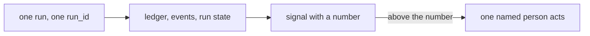

# Design the observability

## The problem

A failure you cannot see, you cannot fix. On a storm night the system runs for hours with nobody watching
each line. You decide ahead of time what it writes down, and who hears about it.

Observability means the system writes enough records that you can ask it why something happened. The
records are the signals. A signal with no number and no person is only a log.



## Your challenge

Open `observability.md`. The `design.md` next to it is the sample with its Failures section. Add
`run_id_field`, then one signal for every failure in `design.md`. Give each signal:

- `failure`: the failure text, copied word for word.
- `signal` and `field`: what is counted, and the name of the number.
- `source`: `ledger`, `events`, `oms` or `run-state`.
- `alert_above`: a number, with its `unit`.
- `tells`: one role, never "the team".
- `action`: what that person does, in at least five words.

For example, the sample answer in `../solution/observability.md` says the run that costs more than
`2` dollars tells the `on-call-engineer` to stop the run.

Do it on your work: take your own agent's worst failure and write its signal. Which record holds the
number, and who gets the alert?

## Done when

- `observability.md` has an Observability section with a `yaml design` block.
- One `run_id_field` ties the records of a run together.
- Every failure in `design.md` has a signal.
- Every signal has a source, a field, a number and a unit.
- Every alert names one person and an action.

```bash
bun run verify design-the-observability
```

Expect: `Done. All 5 rules pass.` and a `Progress:` line.

## If you get stuck

| What you see                                | Fix                                                                   |
| ------------------------------------------- | --------------------------------------------------------------------- |
| `FAIL every failure in design.md ...`       | Copy each `failure:` line from `design.md` exactly, then add a signal. |
| `FAIL every alert names one person ...`     | Use a role such as `desk-lead`. Words like team or everyone fail.     |

## Words you will use

- **Observability**: records that let you ask the system why something happened.
- **Signal**: one number the system writes, with a source and a threshold.
- **Run id**: one label that every record of one run carries.
- **Threshold**: the number above which a person is told.
