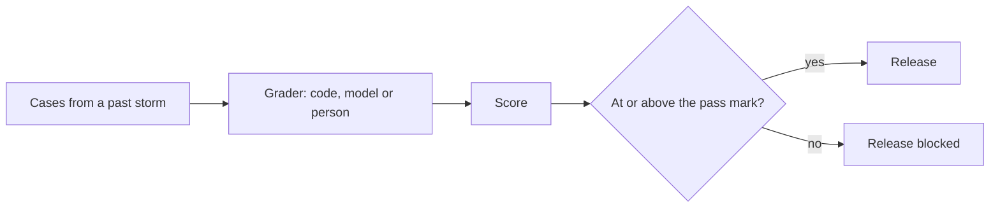

# Plan the evals before a release

## The problem

A new prompt made the customer texts shorter. Nobody saw that three texts now promised power back by a time the crew
plan never gave. With no test set, a customer call found it. An eval is a test set that runs before every release.



## Watch it done

Run the check on the starter:

```bash
bun run verify plan-the-evals
```

Expect:

```text
FAIL  every job a machine does has an eval with a question and a source
FAIL  each pass mark is above 0 and at most 1, and each eval can block a release
2 of 6 rules pass. Fix the FAIL lines and run it again.
```

Then on the finished answer:

```bash
bun run verify plan-the-evals solution
```

Expect:

```text
Done. All 6 rules pass.
```

## Your turn

A grader is the code, model or person that scores one case. The pass mark is the lowest score that lets a release go
out.

Open `design.md` in this folder. Under `## Evals`, write one eval for each job a machine does:

1. Write the `question` the eval asks, in one sentence.
2. Write `cases`, at least 10, and the `source` they come from, such as a past storm.
3. Pick a `grader`: `code`, `model` or `person`. For a model grader, add `checked_by_person`, the number of cases a
   person reads.
4. Set `pass_mark` to a share above 0 and at most 1. Set `gate: block-release`.
5. On the eval for `plan-the-crews`, add `covers_rules`. These are the hard rules in `world/policy.md` that it tests.
   Rule P1 is left out, because no machine touches a switch.

For example, one eval entry looks like this:

```yaml
- job: group-the-reports
  question: Does each report land on the right outage?
  cases: 40
  source: reports from a past storm with the right outage already known
  grader: code
  pass_mark: 0.95
  gate: block-release
```

Then run the check, and fix each FAIL line it prints:

```bash
bun run verify plan-the-evals
```

Expect: `Done. All 6 rules pass.` and a `Progress:` line.

## Do it on your work

Write one eval for the riskiest job in your own agent. Use real past cases, not ones you invent today.

A good answer is one where a stranger can see where the cases come from, and what score blocks a release.

## Done when

- `design.md` has an Evals section with a `yaml design` block.
- Every job a machine does has an eval with a question and a source.
- Each eval has at least ten cases and a grader.
- A model grader has `checked_by_person` filled.
- Each pass mark is above 0 and at most 1, and the gate blocks a release.
- The evals cover rules P2 and P3.

## Solution

The finished files are in the `solution/` folder. To see what changed, run:

```bash
diff -r problem solution
```

Expect: only the parts you fill in are different.

Stuck, or a word you do not know? Open [HELP.md](HELP.md).
