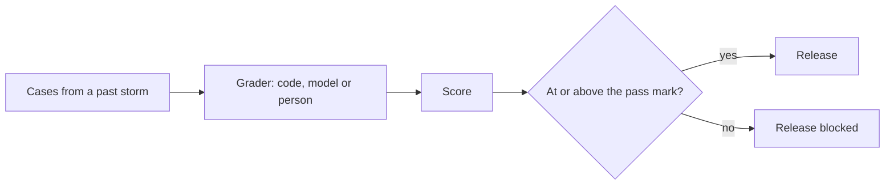

# Plan the evals

## The problem

A new prompt made the customer texts shorter. Nobody noticed that three of them now promised power back by
a time the crew plan never gave. With no test set, the only way to find out was a customer call. An eval
is a test set that runs before every release.



## Your challenge

Open `design.md` in this folder. Under `## Evals`, write one eval for each job a machine does. Each has:

| Field               | What to write                                                        |
| ------------------- | -------------------------------------------------------------------- |
| `question`          | What the eval asks, in one sentence                                  |
| `cases`             | How many cases, at least 10                                          |
| `source`            | Where the cases come from, such as a past storm                      |
| `grader`            | `code`, `model` or `person`                                          |
| `checked_by_person` | For a model grader: how many cases a person reads to trust the model |
| `pass_mark`         | A share above 0 and at most 1                                        |
| `gate`              | `block-release`                                                      |

The eval for `plan-the-crews` also lists `covers_rules`, the hard rules in `world/policy.md` that it tests.
Rule P1 is left out, because no machine touches a switch.

For example, one eval entry looks like this:

```yaml
- job: group-the-reports
  question: Does each report land on the right outage?
  cases: 40
  source: reports from a past storm with the right outage already known
  grader: code
  pass_mark: 0.95
  gate: block-release
```

## Done when

- `design.md` has an Evals section with a `yaml design` block.
- Every job a machine does has an eval with a question and a source.
- Each eval has at least ten cases and a grader.
- A model grader has `checked_by_person` filled.
- Each pass mark is above 0 and at most 1, and the gate blocks a release.
- The evals cover rules P2 and P3.

```bash
bun run verify plan-the-evals
```

Expect: `Done. All 6 rules pass.` and a `Progress:` line.

## If you get stuck

| What you see                                     | Fix                                                                   |
| ------------------------------------------------ | --------------------------------------------------------------------- |
| `FAIL a model grader is checked by a person ...` | Add `checked_by_person: 10` under the eval that uses `grader: model`. |
| `FAIL each pass mark is above 0 ...`             | `pass_mark: 0` lets everything through. Use a share such as 0.9.      |
| `FAIL the evals cover every hard rule ...`       | Add `covers_rules: [P2, P3]` to the crew plan eval.                   |

## Words you will use

- **Eval**: a set of cases and a grader that scores how well a job is done.
- **Grader**: the code, model or person that scores one case.
- **Pass mark**: the lowest score that still lets a release go out.
- **Gate**: a rule that stops a release when an eval falls below its pass mark.
