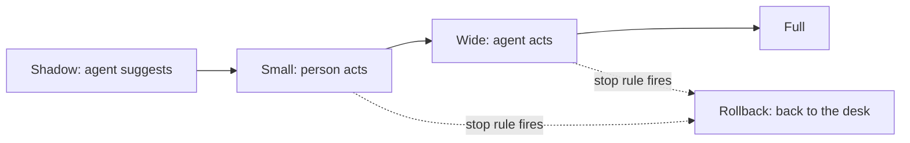

# Plan the rollout

## The problem

Switching the agent on for all 4,200 reports at once means any mistake reaches every customer before anyone
sees it. A rollout is a plan to switch it on in stages. At each stage, a few reports go to the agent and the
evals decide whether to go further. A stop rule pulls it back at once.



## Your challenge

Open `design.md` in this folder. Under `## Rollout`, fill the block:

| Field       | What to write                                                                   |
| ----------- | ------------------------------------------------------------------------------- |
| `stages`    | At least three. Each has `name`, `share_percent`, `who_acts` and `advance_when` |
| `stop_when` | At least two rules, each with a `metric` and a `limit` number                   |
| `rollback`  | `how`, an `owner` and `tested: true`                                            |

The share of reports rises at each stage and ends at 100. The first stage is 10 percent or less, and a
person acts on what the agent suggests. Add one stop rule for rule P2 and one for rule P3 from
`world/policy.md`, each tagged with `rule:`.

For example, one stop rule looks like this:

```yaml
- metric: outages closed while a meter behind them is still dark
  limit: 0
  rule: P2
```

## Done when

- `design.md` has a Rollout section with a `yaml design` block.
- There are at least three stages, and the share grows to 100.
- The first stage is small and a person acts.
- Every stage says what must hold before the next one.
- Stop rules have numbers and cover P2 and P3.
- The way back is owned by a person and has been tried.

```bash
bun run verify plan-the-rollout
```

Expect: `Done. All 6 rules pass.` and a `Progress:` line.

## If you get stuck

| What you see                                 | Fix                                                              |
| -------------------------------------------- | ---------------------------------------------------------------- |
| `FAIL the first stage is small ...`          | Begin with `share_percent: 0` or 10 and `who_acts: person`.      |
| `FAIL stop rules have a number ...`          | Each rule needs `limit: 0` or another number, and a `rule:` tag. |
| `FAIL the way back is owned by a person ...` | An agent cannot be the one to stop itself. Set `owner: person`.  |

## Words you will use

- **Rollout**: switching a change on in stages, not all at once.
- **Shadow**: the agent runs and suggests, but nothing it says is acted on.
- **Stop rule**: a number that, once crossed, pulls the change back.
- **Rollback**: the move that puts the old way back in place.
