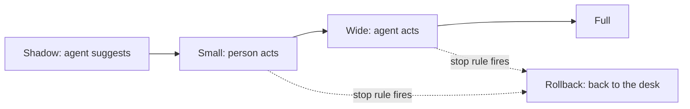

# Plan the rollout in stages

## The problem

Switching the agent on for all 4,200 reports at once means any mistake reaches every customer before anyone sees it. A rollout switches it on in stages. At each stage the evals decide whether to go further, and a stop rule pulls it back at once.



## Watch it done

Run the check on the starter:

```bash
bun run verify plan-the-rollout
```

Expect:

```text
FAIL  the first stage is small and a person acts on every result
FAIL  the way back is owned by a person and has been tried
1 of 6 rules pass. Fix the FAIL lines and run it again.
```

Then on the finished answer:

```bash
bun run verify plan-the-rollout solution
```

Expect:

```text
Done. All 6 rules pass.
```

## Your turn

A stop rule is a number that, once crossed, pulls the change back. The rollback is the move that puts the old
way back in place.

Open `design.md` in this folder. Under `## Rollout`, fill the block:

1. Write at least three `stages`. Each has a `name`, a `share_percent`, `who_acts` and `advance_when`.
2. Let the share rise at each stage and end at 100. The first stage is 10 percent or less, and a person acts.
3. Write at least two `stop_when` rules, each with a `metric` and a `limit` number. Tag one with `rule: P2` and one with `rule: P3`, from `world/policy.md`.
4. Write `rollback`: the `how`, an `owner` who is a person, and `tested: true` once you have tried it.

For example, one stop rule looks like this:

```yaml
- metric: outages closed while a meter behind them is still dark
  limit: 0
  rule: P2
```

Then run the check and fix each FAIL line it prints:

```bash
bun run verify plan-the-rollout
```

Expect: `Done. All 6 rules pass.` and a `Progress:` line.

## Do it on your work

Write the stages for your own agent. Name the first small group that sees it and the number that pulls it back.

Good looks like this: a stranger can say who sees the agent first and who presses the stop button.

## Done when

- `design.md` has a Rollout section with a `yaml design` block.
- There are at least three stages, and the share grows to 100.
- The first stage is small and a person acts.
- Every stage says what must hold before the next one.
- Stop rules have numbers and cover P2 and P3.
- The way back is owned by a person and has been tried.

## Solution

The finished files are in the `solution/` folder. To see what changed, run:

```bash
diff -r problem solution
```

Expect: only the parts you fill in are different.

Stuck, or a word you do not know? Open [HELP.md](HELP.md).
