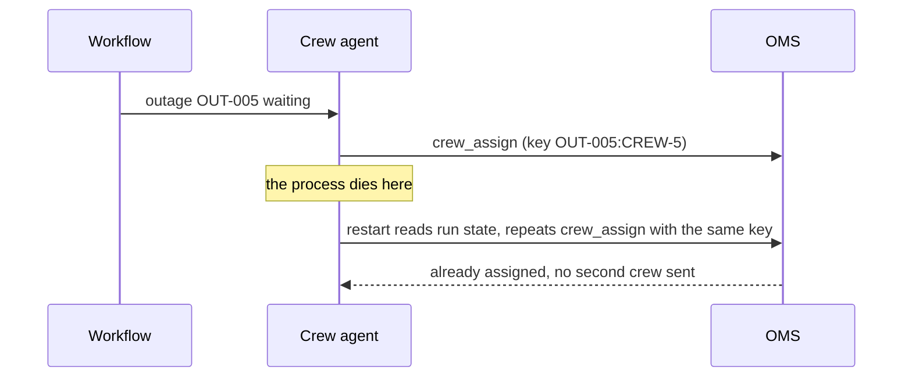

# Plan for failure and cost

## After this part you can

Name the failures, design a safe restart, price an outcome and plan what you watch.

## You leave with

Failures, a restart plan, a price board and a watch plan in `design.md`.

## The problem

Two hard questions arrive in the middle of a storm. First, the process that runs the crew agent dies, and
some crews are assigned while others are not. Second, finance asks what one storm night costs. Your design
needs an answer to both before anyone builds it.

For example, run `bun run storm`. An hour in, the timeline prints a line that sends CREW-5 to OUT-005 on R-F05, with a restore time of a few hours. Now picture the process dying one second after that line. When it starts again, does it send a
second crew to `OUT-005`? It must not.

The fix is an idempotency key. That is a label that makes a repeated action count only once. The sample
harness uses the key `outage:crew` for `crew_assign`, so here the key is `OUT-005:CREW-5`. The restart
repeats the call with the same key, and the OMS answers "already assigned".

The OMS is the outage management system, the database that holds the truth about every outage. Run state
is the record of how far one run got. It must live outside the process, so it survives when the process dies.



A workflow is code that runs fixed steps in a fixed order. In the diagram, the workflow hands one waiting
outage to the agent.

Now the cost question. The number that decides whether the system pays is the cost per outcome. That is
what you spend to get one useful result, such as one outage handled.

The bottom of the storm board gives you real numbers:

```text
  Model calls                             3,178
  Model cost of the storm night           $0.15
  Model cost per outage found             $0.005
```

Cost comes from tokens. A token is a small piece of text, often part of a word. Prices are per million
tokens. In `config/models.ts`, the `smart` role costs `$2` per million input tokens and `$10` per million
output tokens. The `fast` role costs `$0.1` and `$0.5`.

Compare this with one public case. Freedom Forever is the largest home solar installer in the United States.
It reports that its permit email agent processed about 19,000 emails in its first month. It says it fully
handled "about 71%" of them. Each run cost $0.20 to $0.35, which it calls "two to five times less than the
human equivalent" ([Claude customer story, Freedom Forever](https://claude.com/customers/freedom-forever)).
This is a vendor claim, so read it with care.

| Step                       | Minutes | You produce                                                                                           |
| -------------------------- | ------- | ----------------------------------------------------------------------------------------------------- |
| `name-the-failures`        | 20      | `## Failures`: at least five failure modes, how each shows up, how it is caught, what the system does |
| `design-the-restart`       | 20      | `## Restart`: where run state lives, idempotency keys, step and money budget per run                  |
| `price-the-outcome`        | 20      | `cost.yaml` and the cost board for a normal and a storm month                                         |
| `plan-the-evals`           | 20      | `## Evals`: a test set, a pass bar and a control for each risk                                        |
| `plan-the-rollout`         | 20      | `## Rollout`: stages, a stop rule and a way back                                                      |
| `design-the-observability` | 20      | `observability.md`: one signal for each failure, with a number and one person to tell                 |

A failure mode is one way the system can go wrong, such as a tool that fails or a person who never answers.
A budget per run is the most steps and dollars one run may spend before it stops and asks a person. A storm
month at Copperbeck has `420` outages. A normal month has `140`.

Each step's `problem/design.md` starts with the sections from the steps before it, copied from their sample
answers. So you can begin at any step.

## Steps

| Step                       | What you do                                                           |
| -------------------------- | --------------------------------------------------------------------- |
| `name-the-failures`        | Run `bun run verify name-the-failures` until every rule passes        |
| `design-the-restart`       | Run `bun run verify design-the-restart` until every rule passes       |
| `price-the-outcome`        | Run `bun run verify price-the-outcome` until every rule passes        |
| `design-the-observability` | Run `bun run verify design-the-observability` until every rule passes |

## Watch and read

| Kind  | Title                                        | Who made it                                         | Why                                                                    | Link                                                              |
| ----- | -------------------------------------------- | --------------------------------------------------- | ---------------------------------------------------------------------- | ----------------------------------------------------------------- |
| read  | Monitoring distributed systems               | Google SRE team                                     | The team that runs Google production on what to watch and alert on.    | https://sre.google/sre-book/monitoring-distributed-systems/       |
| read  | Alerting on SLOs                             | Google SRE team                                     | Every alert needs a number and an owner.                               | https://sre.google/workbook/alerting-on-slos/                     |
| read  | Designing robust APIs with idempotency       | Brandur Leach, Stripe                               | The source of the idempotency key idea used in the restart step.       | https://stripe.com/blog/idempotency                               |
| read  | How we built our multi-agent research system | Anthropic engineering                               | The team that runs it shares real token costs and failures.            | https://www.anthropic.com/engineering/multi-agent-research-system |
| video | Why AI evals matter                          | Hamel Husain and Shreya Shankar, on Lenny's Podcast | Two people who run evals for a living show how to check an AI product. | https://www.youtube.com/watch?v=BsWxPI9UM4c                       |
| video | How we build effective agents                | Barry Zhang, Anthropic                              | The maker of the method explains when an agent is worth its cost.      | https://www.youtube.com/watch?v=D7_ipDqhtwk                       |

## Project

Name three ways your own system can fail and the check that catches each.

## Walkthrough

You work in each step's `problem/` folder. Open its `README.md`, fill the empty section, then run the check.

First, see a passing answer. This runs the check on the sample answer for the first step:

```bash
bun run verify name-the-failures solution
```

Expect: `Done. All 4 rules pass.`

Now fill `## Failures` in `parts/03-plan-for-failure-and-cost/01-name-the-failures/problem/design.md`.

```bash
bun run verify name-the-failures
```

Expect: `Done. All 4 rules pass.` once your Failures section is filled.

```bash
bun run verify design-the-restart
```

Expect: `Done. All 5 rules pass.` once your Restart section is filled.

For the last step, run the storm night to get real token counts in `world/state/ledger.jsonl`.

```bash
bun run storm
```

Expect: `Storm night replayed.` as the last line.

Fill `cost.yaml` in `03-price-the-outcome/problem/`, then print its price board.

```bash
bun parts/03-plan-for-failure-and-cost/price-the-outcome.ts
```

Expect: the price board for one outage handled, once `cost.yaml` is filled.

```bash
bun run verify price-the-outcome
```

Expect: `Done. All 6 rules pass.` once your board fits the value and the budget.

When all three pass, check the whole part.

```bash
bun run verify part plan-for-failure-and-cost
```

Expect: `Part plan-for-failure-and-cost is done: 6/6 steps pass.` once all six steps pass.

The full output then looks like this:

```text
Part plan-for-failure-and-cost:
  PASS   name-the-failures  (4/4 rules)
  PASS   design-the-restart  (5/5 rules)
  PASS   price-the-outcome  (6/6 rules)
  PASS   plan-the-evals
  PASS   plan-the-rollout
  PASS   design-the-observability  (5/5 rules)
Part plan-for-failure-and-cost is done: 6/6 steps pass.
```

## Assignment

The process dies in the middle of a storm with some crews assigned and others not. Then finance asks what a
storm night costs. Hand in the Failures and Restart sections of `design.md`, your `cost.yaml`, and its price
board.

Each question has a yes or no answer. The script answers the first four.

| #   | Question                                                                         | Who answers |
| --- | -------------------------------------------------------------------------------- | ----------- |
| 1   | Does `bun run verify part plan-for-failure-and-cost` pass?                       | script      |
| 2   | Are there five failures, one of each kind, each caught by a named check?         | script      |
| 3   | Does every write tool have an idempotency key with no time or random part?       | script      |
| 4   | Is the cost per outcome below its value, and the storm month under budget?       | script      |
| 5   | Does each `system_does` leave the OMS correct, even if the run never comes back? | grader      |

Go further: price the same design with `plan-the-crews` on the `fast` role. Then write which role you would
pick. At what number of outages a month would your choice flip?

## Finished

You now know how your design fails and what it costs. For example, the sample answer handles one outage for
about half a cent, and a storm month of `420` outages costs about two dollars.

The next part, [Decide and defend](../04-decide-and-defend/README.md), turns these choices into decision
records. Then it takes your design to a review board.
