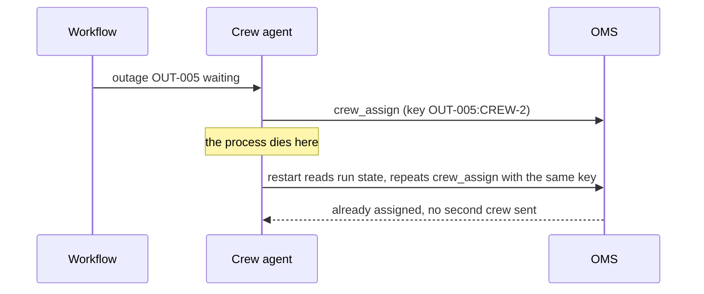

# Plan for failure and cost

Status: planned. A part session builds the step folders from [PARTS.md](../../PARTS.md).

## The problem

Two hard questions arrive in the middle of a storm. First, the process that runs the crew agent dies, and
some crews are assigned while others are not. Second, finance asks what one storm night costs. Your design
needs an answer to both before anyone builds it.

For example, run `bun run storm`. At `+60 min` the board prints `CREW-5 to OUT-005 on R-F05, restore in about
200 min`. Now picture the process dying one second after that line. When it starts again, does it send a
second crew to `OUT-005`? It must not.

The fix is an idempotency key. That is a label that makes a repeated action count only once. The sample
harness uses the key `outage:crew` for `crew_assign`, so here the key is `OUT-005:CREW-5`. The restart
repeats the call with the same key, and the OMS answers "already assigned".

The OMS is the outage management system, the database that holds the truth about every outage. Run state
is the record of how far one run got. It must live outside the process, so it survives when the process dies.



A workflow is code that runs fixed steps in a fixed order. In the diagram, the workflow hands one waiting
outage to the agent.

Now the cost question. The number that decides whether the system pays is the cost per outcome. That is
what you spend to get one useful result, such as one outage handled.

The bottom of the storm board gives you real numbers:

```text
  Model calls                             3,178
  Model cost of the storm night           $0.15
  Model cost per outage found             $0.005
```

Cost comes from tokens. A token is a small piece of text, often part of a word. Prices are per million
tokens. In `config/models.ts`, the `smart` role costs `$2` per million input tokens and `$10` per million
output tokens. The `fast` role costs `$0.1` and `$0.5`.

Compare this with one public case. Freedom Forever is the largest home solar installer in the United States.
It reports that its permit email agent processed about 19,000 emails in its first month. It says it fully
handled "about 71%" of them. Each run cost $0.20 to $0.35, which it calls "two to five times less than the
human equivalent" ([Claude customer story, Freedom Forever](https://claude.com/customers/freedom-forever)).
This is a vendor claim, so read it with care.

| Step                 | Minutes | You produce                                                                                           |
| -------------------- | ------- | ----------------------------------------------------------------------------------------------------- |
| `name-the-failures`  | 20      | `## Failures`: at least five failure modes, how each shows up, how it is caught, what the system does |
| `design-the-restart` | 20      | `## Restart`: where run state lives, idempotency keys, step and money budget per run                  |
| `price-the-outcome`  | 20      | `cost.yaml` and the cost board for a normal and a storm month                                         |

A failure mode is one way the system can go wrong, such as a tool that fails or a person who never answers.
A budget per run is the most steps and dollars one run may spend before it stops and asks a person. A storm
month at Copperbeck has `420` outages. A normal month has `140`.

## Walkthrough

TODO(part session): write the walkthrough once the steps exist.

```bash
bun run verify name-the-failures
```

Expect: TODO(part session)

```bash
bun run verify design-the-restart
```

Expect: TODO(part session)

```bash
bun run verify price-the-outcome
```

Expect: TODO(part session)
