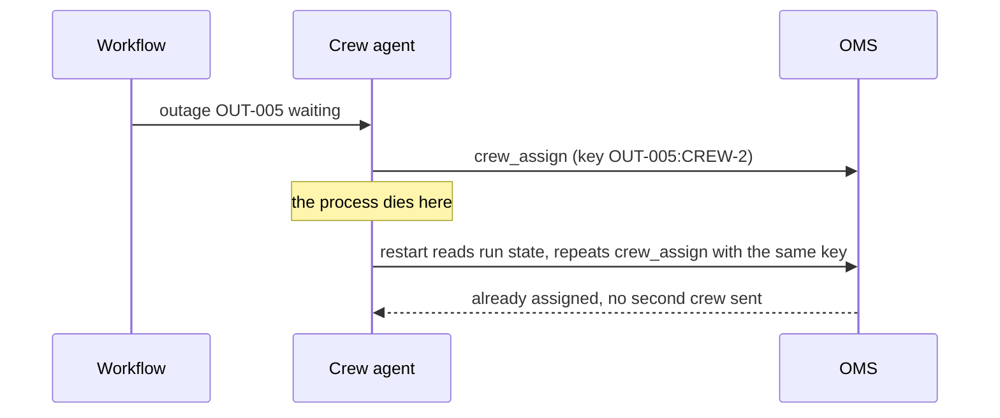

# Plan for failure and cost

Status: planned. A part session builds the step folders from [PARTS.md](../../PARTS.md).

## The problem

Mid storm, the process running the crew agent dies with crews half assigned, and finance asks what one storm
night costs. A design needs answers to both before anyone builds. Cost per outcome is the number that
decides whether the system pays: Freedom Forever, the largest residential solar installer in the United
States, reports that its permit email agent processed "approximately 19,000 emails in its first month",
fully handled "about 71%", and that "each execution costs $0.20–$0.35", "two to five times less than the
human equivalent" ([Claude customer story, Freedom Forever](https://claude.com/customers/freedom-forever),
a vendor claim, read 12 Nov 2026).



| Step | Minutes | You produce |
|---|---|---|
| `name-the-failures` | 20 | `## Failures`: at least five failure modes, how each shows up, how it is caught, what the system does |
| `design-the-restart` | 20 | `## Restart`: where run state lives, idempotency keys, step and money budget per run |
| `price-the-outcome` | 20 | `cost.yaml` and the cost board for a normal and a storm month |

## Walkthrough

TODO(part session): write the walkthrough once the steps exist.

```bash
bun run verify name-the-failures
```

Expect: TODO(part session)

```bash
bun run verify design-the-restart
```

Expect: TODO(part session)

```bash
bun run verify price-the-outcome
```

Expect: TODO(part session)
