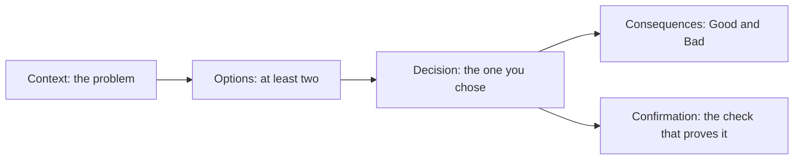

# Record the decisions

## The problem

Your design is full of choices. In a few months, someone will ask why you made them. If the reason lives
only in your head, the next person may undo a good choice without knowing what it protected.

An ADR (architecture decision record) is a short file for one choice. It says what you chose, which options
you turned down, what gets worse, and how you will check the choice works. This course uses the MADR 4.0.0
template ([adr/madr](https://github.com/adr/madr/blob/develop/template/adr-template.md)). MADR marks the
Confirmation section as optional. Here it is required, because a decision nobody checks soon drifts.



## Your challenge

Write three ADRs in `adr/`. The starter has three empty files:

- `0001-the-shape.md`: which jobs are agents. Link it to `../design.md#shape`.
- `0002-the-riskiest-gate.md`: the gate on your riskiest tool. Link it to `../design.md#gates`.
- `0003-the-cost.md`: your cost choice. Link it to `../cost.yaml`.

You may rename each file after its title, such as `0002-a-person-approves-every-customer-text.md`. Keep
the four digits and the dashes. Delete the old empty file.

Each ADR needs:

- `status:` in the front matter: `proposed`, `accepted`, `rejected`, `deprecated` or `superseded`.
- A title, then the headings in the template.
- At least two options under `## Considered Options`, each a bullet.
- At least one bullet under `### Consequences` that starts with `Bad,`.
- A `### Confirmation` that names a step check, such as `bun run verify place-the-gates`.

For example, the sample ADR on the riskiest gate ends like this:

```markdown
### Consequences

- Good, because no text leaves without a person reading it.
- Good, because rule P3 holds: a critical customer always hears a person.
- Bad, because customers wait up to 10 more minutes for their text when the desk is busy.

### Confirmation

`bun run verify place-the-gates` passes: every tier-high tool has a gate, and no gate proceeds on timeout.
```

The `Bad,` line is honest: a gate slows every text down. A reviewer trusts an ADR that says what it costs.

## Done when

- `adr/` holds at least three files named like `0001-short-title.md`.
- Every ADR has the MADR headings, Confirmation included, and a status from the MADR list.
- Every ADR lists at least two options and at least one `Bad,` consequence.
- Every Confirmation names a step check.
- Every ADR links to the design section or `cost.yaml` it decides, and that section exists.
- Between them, the ADRs decide the shape, a gate and the cost.

```bash
bun run verify record-the-decisions
```

Expect: `Done. All 8 rules pass.` and a `Progress:` line.

## If you get stuck

| What you see                                        | Fix                                                      |
| --------------------------------------------------- | -------------------------------------------------------- |
| `FAIL every ADR names at least one bad consequence` | Start a bullet with `Bad,` and say what gets worse.      |
| `FAIL every Confirmation names the step ...`        | Name a check such as `bun run verify price-the-outcome`. |
| `FAIL every ADR links to the design section ...`    | Write the link as `[Gates](../design.md#gates)`.         |
| `FAIL` lines after you add renamed files            | Delete the old empty files in `adr/`.                    |

## Words you will use

- **Considered options**: the choices you weighed, the winner and the ones you turned down.
- **Consequence**: what changes because of the choice, good or bad.
- **Confirmation**: how you will check that the choice was carried out.
