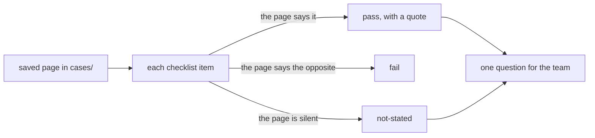

# Review a real system

## The problem

Teams copy what they read in customer stories. But a story is written to sell. A reviewer reads it the way a
doctor reads a test result: what was measured, against what base, and who checked it?



## Watch it done

Check the starter:

```bash
bun run verify review-a-real-system
```

Expect:

```text
FAIL  every checklist item is answered once with pass, fail or not-stated
FAIL  at least one item is not stated
2 of 5 rules pass. Fix the FAIL lines and run it again.
```

Then the answer:

```bash
bun run verify review-a-real-system solution
```

Expect:

```text
Done. All 5 rules pass.
```

## Your turn

For example, the AES story says "96% faster" for audit results. The same page says "Reduced audit costs by
99%". Faster than what? 99% of which costs? The page does not say. So a reviewer marks that item "not
stated" and asks the team.

You review one real system with the same checklist your own design must pass. Its saved page is in
`../cases/`.

Pick one case: `freedom-forever` or `aes`. Rename `review-freedom-forever.md` to match it, such as
`review-aes.md`. Under `## Review`, set `case:` and answer each item:

| Item               | The question                                               |
| ------------------ | ---------------------------------------------------------- |
| `outcome`          | Does it name the result, not only the activity?            |
| `metric-base`      | Does each headline number say what it is counted against?  |
| `shape`            | Does it say whether code or the model picks the next step? |
| `human-gate`       | Does it say where a person signs off before an action?     |
| `failure-path`     | Does it say what happens when the system is wrong?         |
| `cost-per-outcome` | Does it give a cost for one result?                        |
| `system-of-record` | Does it say where the truth is checked?                    |

Answer each with `pass`, `fail` or `not-stated`. A `pass` needs a `quote` of at least 5 words, copied from
the case file. Then write one `question` for the team about a denominator or a gate.

For example, the sample answer for Freedom Forever has:

```yaml
- item: cost-per-outcome
  answer: pass
  quote: Each execution costs $0.20–$0.35 and completes in about two minutes
```

Its question asks for the base: "Of the 19,000 emails, how many did a person check after the agent acted, and
how many of those were wrong?"

Then run the check and fix each FAIL:

```bash
bun run verify review-a-real-system
```

Expect: `Done. All 5 rules pass.` and a `Progress:` line.

## Do it on your work

Make the same move on your own system, with your own tools, people and numbers.

Good looks like this: a stranger can name your tool, person and number.

## Done when

- A `review-<case>.md` file has a Review block, and `case:` names a file in `cases/`.
- Every checklist item is answered once with `pass`, `fail` or `not-stated`.
- Every pass quotes at least 5 words found in the saved page.
- At least one item is `not-stated`.
- The question asks for a denominator or about a gate, in at least 8 words, and ends with `?`.

## Solution

The finished files are in `solution/`. Compare:

```bash
diff -r problem solution
```

Expect: only the parts you fill in are different.

Stuck? See [HELP.md](HELP.md).
