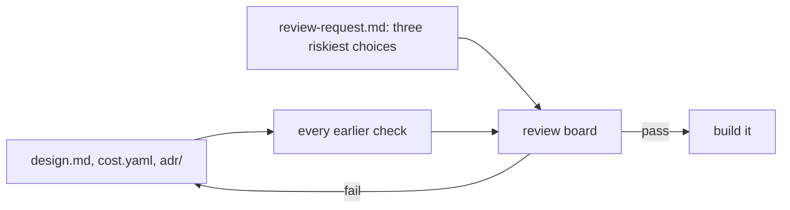
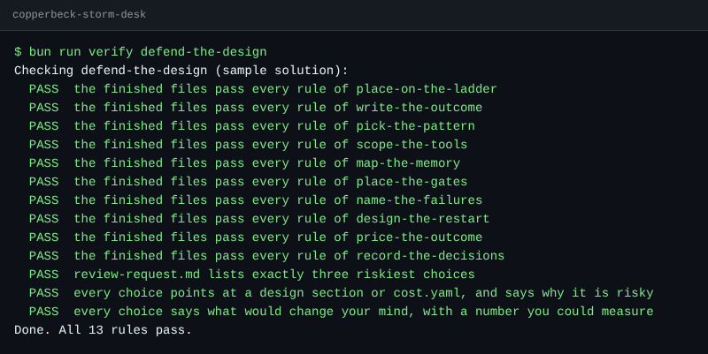

# Defend the design

## The problem

The review board meets for a short slot. Three people sit on it: finance, security, and the head of control room
operations. They cannot read every line. So you tell them where to push.



## Watch it done

Check the starter:

```bash
bun run verify defend-the-design
```

Expect:

```text
FAIL  review-request.md lists exactly three riskiest choices
FAIL  every choice points at a design section or cost.yaml, and says why it is risky
10 of 13 rules pass. Fix the FAIL lines and run it again.
```

Then the answer:

```bash
bun run verify defend-the-design solution
```

Expect:

```text
Done. All 13 rules pass.
```

## Your turn

A good review request does two things. It names your riskiest choices. And for each one, it says what evidence would
change your mind. "I would change it if it felt wrong" gives the board nothing to test. "I would change it if one desk
lead saw many gates in one storm night shift" does.

This folder holds a finished design: `design.md`, `cost.yaml` and `adr/`, copied from the sample answers. Put your own
files from the earlier steps here instead, if you like.

Then fill in `review-request.md`. Under the Riskiest choices heading, list exactly three choices. Give each:

- `choice`: the choice in one line.
- `section`: where it lives. A heading in `design.md`, such as `Gates`, or `cost.yaml`.
- `why_risky`: what goes wrong if the choice is wrong, in at least 8 words.
- `would_change_my_mind`: evidence you could count, with a number, in at least 10 words.

For example, the sample answer has this choice:

```yaml
- choice: the desk lead approves every customer text, once per outage
  section: Gates
  why_risky: on a storm night the desk lead may click yes without reading, like 93% of prompts
  would_change_my_mind: more than 40 gates for one desk lead in one storm night shift
```

The check then runs every earlier step's check on these files. Your finished design must still pass them all.

The finished check looks like this once every part is in place:



**Go further.** Open `../examples/over-built.md`. It is another team's design with five faults. Find all five with the
checklist. Then compare your list with `../solution/over-built-faults.md`.

Then run the check, and fix each FAIL:

```bash
bun run verify defend-the-design
```

Expect: a `PASS` line for each earlier step and `Done.` once `review-request.md` is filled.

## Do it on your work

Make the same move on your own system, with your own tools, people and numbers.

A good answer is one where a stranger can name your tool, person and number.

## Done when

- The finished files pass every rule of every earlier step that reads the design.
- `review-request.md` lists exactly three riskiest choices.
- Every choice points at a design section or `cost.yaml`, and says why it is risky.
- Every choice says what would change your mind, with a number.

## Solution

The finished files are in `solution/`. Compare:

```bash
diff -r problem solution
```

Expect: only the parts you fill in are different.

Stuck? See [HELP.md](HELP.md).
