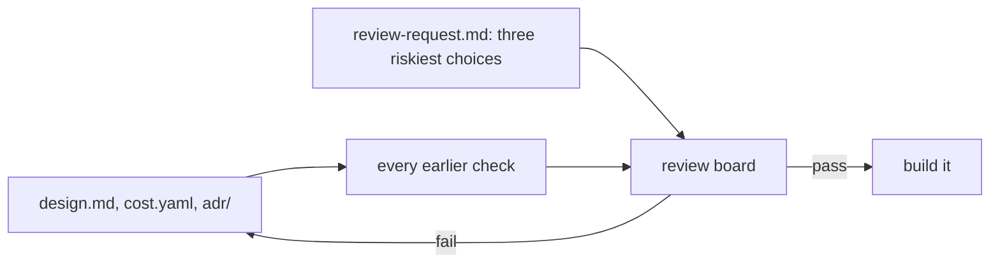
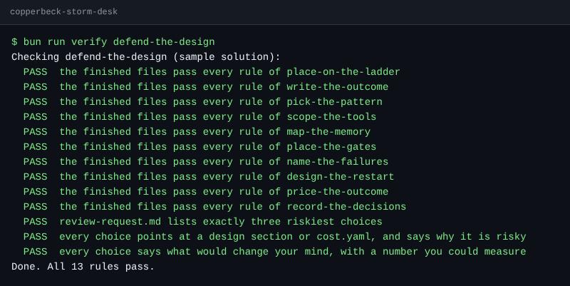

# Defend the design

## The problem

The review board meets for 20 minutes. Three people sit on it: finance, security, and the head of control
room operations. They cannot read every line. So you tell them where to push.

A good review request does two things. It names your riskiest choices. And for each one it says what
evidence would change your mind. "I would change it if it felt wrong" gives the board nothing to test. "I
would change it if one desk lead saw more than 40 gates in one storm night shift" does.



## Your challenge

This folder holds a finished design: `design.md`, `cost.yaml` and `adr/`, copied from the sample answers.
Put your own files from the earlier steps here instead, if you like.

Then fill `review-request.md`. Under `## Riskiest choices`, list exactly three choices. Give each:

- `choice`: the choice in one line.
- `section`: where it lives: a heading in `design.md`, such as `Gates`, or `cost.yaml`.
- `why_risky`: what goes wrong if the choice is wrong, in at least 8 words.
- `would_change_my_mind`: evidence you could count, with a number, in at least 10 words.

For example, the sample answer has this choice:

```yaml
- choice: the desk lead approves every customer text, once per outage
  section: Gates
  why_risky: on a storm night the desk lead may click yes without reading, like 93% of prompts
  would_change_my_mind: more than 40 gates for one desk lead in one storm night shift
```

The check then runs every earlier step's check on these files. Your finished design must still pass them
all.

The finished check looks like this once every part is in place:



**Go further.** Open `../examples/over-built.md`. It is another team's design with five faults. Find all
five with the checklist. Then compare your list with `../solution/over-built-faults.md`.

## Done when

- The finished files pass every rule of every earlier step that reads the design.
- `review-request.md` lists exactly three riskiest choices.
- Every choice points at a design section or `cost.yaml`, and says why it is risky.
- Every choice says what would change your mind, with a number.

```bash
bun run verify defend-the-design
```

Expect: a `PASS` line for each earlier step and `Done.` once `review-request.md` is filled.

## If you get stuck

| What you see                                             | Fix                                                              |
| -------------------------------------------------------- | ---------------------------------------------------------------- |
| `FAIL the finished files pass every rule of ...`         | Run `bun run verify` with that step name to see the rule.        |
| `FAIL every choice points at a design section ...`       | Use a heading as it is written, such as `Gates`, or `cost.yaml`. |
| `FAIL every choice says what would change your mind ...` | Add a number you could count, such as `more than 40 gates`.      |

## Words you will use

- **Review board**: the people who must agree before anyone builds the design.
- **Review request**: the page that tells the board where to push.
- **Evidence**: something you could count or measure, not a feeling.
