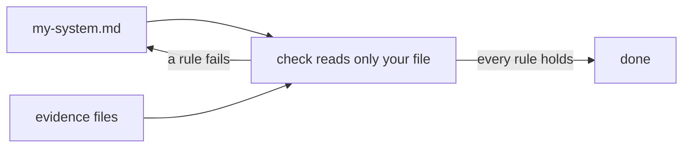

# Design your own system

## The problem

You have designed the storm desk. Now do the same for a job of your own. The check here never reads the
storm desk. It reads your file, and it asks for proof that your system ran at least once.



## Your challenge

Open `my-system.md`. Fill each section about a real job from your work or study. For example, a shop that sends refunds by hand could become a returns desk with a refund tool and a gate.

- `## System`: the name, the outcome, who owns it, its rung on the ladder, and why it needs an agent.
- `## Tools`: at least two tools. Say if each one reads or writes, if it can be undone, and its tier.
- `## Gates`: a gate for every write that cannot be undone. A person decides, and the timeout never proceeds.
- `## Failures`: at least three. Each one is caught by a check that reads something, and says what happens next.
- `## Cost`: the cost per outcome and the value per outcome as numbers, and where you got them.
- `## Evidence`: at least two real files from your own work, such as a run log or a screenshot.

Put the evidence files in an `evidence/` folder next to `my-system.md`. The sample answer in
`../solution/my-system.md` is a small online shop. Read it for the shape, then write yours.

Do it on your work: this whole step is the move. Use your own job, your own tools and your own numbers.

## Done when

- `my-system.md` has all six sections with a `yaml design` block each.
- The system has an owner, a rung and a reason.
- Every write that cannot be undone has a gate that never proceeds on a timeout.
- Three failures are each caught by a check.
- The cost per outcome is below the value per outcome.
- Two evidence files exist and are not empty.

```bash
bun run verify design-your-own-system
```

Expect: `Done. All 7 rules pass.` and a `Progress:` line.

## If you get stuck

| What you see                                 | Fix                                                                 |
| -------------------------------------------- | ------------------------------------------------------------------- |
| `FAIL every write that cannot be undone ...` | Add a gate that lists that tool. Set `on_timeout` to `wait`.        |
| `FAIL at least two evidence files ...`       | Make the files first. Then list their paths under `## Evidence`.    |
| `FAIL the cost per outcome ...`              | Use numbers, not words. If cost is above value, rethink the design. |

## Words you will use

- **Artefact**: a file you made that someone else can check.
- **Evidence**: a real file that shows your system ran, such as a log.
- **Rung**: how much the model decides, from a person up to many agents.
