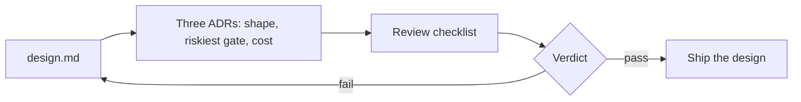

# Decide and defend

Status: planned. A part session builds the step folders from [PARTS.md](../../PARTS.md).

## The problem

Your design now goes to a review board. That is a group of people who must agree before anyone builds it.
This board has three doubters: finance, security, and the head of control room operations. Each one asks
what a number means before they trust it.

The first question a reviewer asks is always the same: compared with what? A number with no base can mean
almost anything.

For example, run `bun run storm` and read the first line of the board at the end:

```text
  Outages found                           31 of 31 (+5 false)
```

The "31 of 31" alone looks perfect. The `+5 false` tells the rest: the system also opened 5 outages that
were not real. The 31 matches the `31` outages of a storm night in `world/desk.yaml`, so you know the base.

Public cases need the same care. AES's story says "96% faster" for audit results. The same page also says
"Reduced audit costs by 99%" ([Claude customer story, AES](https://claude.com/customers/aes), a vendor
claim). Faster than what? And 99% of which costs? The page does not say, so a reviewer marks it "not stated".



Read the diagram from left to right. You turn your `design.md` into three ADRs. An ADR (architecture
decision record) is a short file that records one choice, the options you turned down, and why. Then the
board checks them against a list. If the design fails, you go back and fix `design.md`.

| Step                   | Minutes | You produce                                                                                             |
| ---------------------- | ------- | ------------------------------------------------------------------------------------------------------- |
| `record-the-decisions` | 20      | Three ADRs in `adr/`, MADR 4.0.0 form, each with a Confirmation section                                 |
| `review-a-real-system` | 20      | `review-<case>.md`: the checklist applied to one public system, every pass quoted                       |
| `defend-the-design`    | 20      | The finished design and `review-request.md`: the three riskiest choices and what would change your mind |

MADR is a common template for ADRs, and the course uses version 4.0.0. Its Confirmation section says how
you will check that the choice was carried out. In your ADRs, it names a check.

In the review step you test one public system against the checklist. You mark each item pass, fail or not
stated. Every pass must quote the source, so a reviewer can find the words.

## Walkthrough

TODO(part session): write the walkthrough once the steps exist.

```bash
bun run verify record-the-decisions
```

Expect: TODO(part session)

```bash
bun run verify review-a-real-system
```

Expect: TODO(part session)

```bash
bun run verify defend-the-design
```

Expect: TODO(part session)
