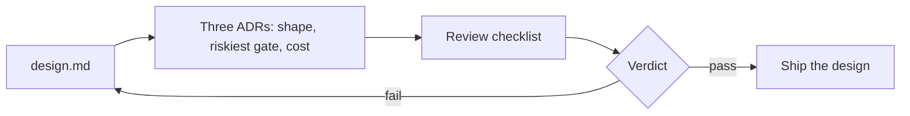

# Decide and defend

Status: planned. A part session builds the step folders from [PARTS.md](../../PARTS.md).

## The problem

A review board has three skeptics: finance, security and the head of control room operations. Each will
ask what a number means before they trust it. Even one public case can carry two claims: AES's story says
"96% faster" for audit results and also "Reduced audit costs by 99%"
([Claude customer story, AES](https://claude.com/customers/aes), a vendor claim). Faster than what, and
99% of which costs? A reviewer's first question is always: compared with what?



| Step                   | Minutes | You produce                                                                                             |
| ---------------------- | ------- | ------------------------------------------------------------------------------------------------------- |
| `record-the-decisions` | 20      | Three ADRs in `adr/`, MADR 4.0.0 form, each with a Confirmation section                                 |
| `review-a-real-system` | 20      | `review-<case>.md`: the checklist applied to one public system, every pass quoted                       |
| `defend-the-design`    | 20      | The finished design and `review-request.md`: the three riskiest choices and what would change your mind |

## Walkthrough

TODO(part session): write the walkthrough once the steps exist.

```bash
bun run verify record-the-decisions
```

Expect: TODO(part session)

```bash
bun run verify review-a-real-system
```

Expect: TODO(part session)

```bash
bun run verify defend-the-design
```

Expect: TODO(part session)
