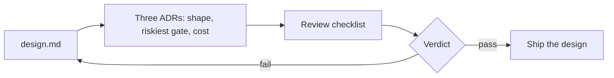

# Decide and defend

## The problem

Your design now goes to a review board. That is a group of people who must agree before anyone builds it.
This board has three doubters: finance, security, and the head of control room operations. Each one asks
what a number means before they trust it.

The first question a reviewer asks is always the same: compared with what? A number with no base can mean
almost anything.

For example, run `bun run storm` and read the first line of the board at the end:

```text
  Outages found                           31 of 31 (+5 false)
```

The "31 of 31" alone looks perfect. The `+5 false` tells the rest: the system also opened 5 outages that
were not real. The 31 matches the `31` outages of a storm night in `world/desk.yaml`, so you know the base.

Public cases need the same care. AES's story says "96% faster" for audit results. The same page also says
"Reduced audit costs by 99%" ([Claude customer story, AES](https://claude.com/customers/aes), a vendor
claim). Faster than what? And 99% of which costs? The page does not say, so a reviewer marks it "not stated".



Read the diagram from left to right. You turn your `design.md` into three ADRs. An ADR (architecture
decision record) is a short file that records one choice, the options you turned down, and why. Then the
board checks them against a list. If the design fails, you go back and fix `design.md`.

| Step                   | Minutes | You produce                                                                                             |
| ---------------------- | ------- | ------------------------------------------------------------------------------------------------------- |
| `record-the-decisions` | 20      | Three ADRs in `adr/`, MADR 4.0.0 form, each with a Confirmation section                                 |
| `review-a-real-system` | 20      | `review-<case>.md`: the checklist applied to one public system, every pass quoted                       |
| `defend-the-design`    | 20      | The finished design and `review-request.md`: the three riskiest choices and what would change your mind |

MADR is a common template for ADRs, and the course uses version 4.0.0. Its Confirmation section says how
you will check that the choice was carried out. In your ADRs, it names a check.

In the review step you test one public system against the checklist. You mark each item pass, fail or not
stated. Every pass must quote the source, so a reviewer can find the words.

Each step's `problem/` folder starts with the finished design from the steps before it, copied from their
sample answers. So you can begin at any step.

## Walkthrough

You work in each step's `problem/` folder. Open its `README.md`, fill the empty files, then run the check.

First, see a passing answer. This runs the check on the three sample ADRs:

```bash
bun run verify record-the-decisions solution
```

Expect: `Done. All 8 rules pass.`

Now fill the three ADRs in `parts/04-decide-and-defend/01-record-the-decisions/problem/adr/`.

```bash
bun run verify record-the-decisions
```

Expect: `Done. All 8 rules pass.` once your three ADRs are filled.

Pick a case in `02-review-a-real-system/cases/` and fill your review.

```bash
bun run verify review-a-real-system
```

Expect: `Done. All 5 rules pass.` once your review is filled.

```bash
bun run verify defend-the-design
```

Expect: a `PASS` line for each earlier step and `Done.` once `review-request.md` is filled.

When all three pass, check the whole part.

```bash
bun run verify part decide-and-defend
```

Expect: `Part decide-and-defend is done: 3/3 steps pass.` once all three steps pass.

The full output then looks like this:

```text
Part decide-and-defend:
  PASS   record-the-decisions  (8/8 rules)
  PASS   review-a-real-system  (5/5 rules)
  PASS   defend-the-design  (13/13 rules)
Part decide-and-defend is done: 3/3 steps pass.
```

## Assignment

A review board has 20 minutes and three doubters: finance, security, and the head of control room
operations. Hand in three ADRs, `review-<case>.md` and `review-request.md`, next to your finished
`design.md` and `cost.yaml`.

Each question has a yes or no answer. The script answers the first four.

| #   | Question                                                                               | Who answers |
| --- | -------------------------------------------------------------------------------------- | ----------- |
| 1   | Does `bun run verify part decide-and-defend` pass?                                     | script      |
| 2   | Does each ADR name a Confirmation check and at least one bad consequence?              | script      |
| 3   | Does every pass in the review quote text found in the saved copy of the source?        | script      |
| 4   | Does each riskiest choice say what would change your mind, with a number?              | script      |
| 5   | Is the review question about a denominator or a gate that the page really leaves open? | grader      |

Go further: grade `03-defend-the-design/examples/over-built.md` with the same checklist and find its five
faults.

## Finished

You now have a design a review board can test. For example, your gate ADR names `place-the-gates` as its
Confirmation, so anyone can run the check and see the gate still holds.

This is the last part. Your project is the folder you hand in: `design.md`, `cost.yaml`, `adr/`, a review
of a real system and a review request. The [rubric](../../rubric.md) lists every question it must answer
yes to.
