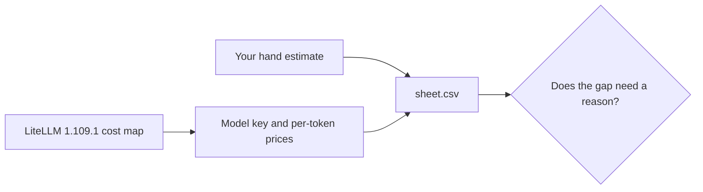

# Price the design

## The problem

In `price-the-outcome` you worked out the monthly model cost by hand. You typed the prices in yourself,
so the figure is only as good as your typing. Teams that run agents avoid this. They read prices from one
shared list.

LiteLLM is an open-source tool that sits between an app and its model providers. It ships a cost map. A cost
map is a file that lists the price per token of each model, under a model key such as the one in
`config/models.ts`. This course pins LiteLLM `1.109.1`, and `config/litellm-cost-map.csv` holds a copy of
the Claude and GPT rows from that release.

For example, one key holds three prices: input, cached input and output, each in dollars per token. Multiply
them by the tokens of one call and you have the cost of that call.



## Your challenge

Open `sheet.csv`. It lists the model calls of the sample design, with the hand estimate for a storm month
already filled in. Fill the last three columns on every row:

- `model_key`: the key from `config/litellm-cost-map.csv` for the model that role uses. The ids in
  `config/models.ts` are those keys.
- `litellm_version`: the LiteLLM release you read the price from.
- `litellm_monthly_usd`: the storm month cost at that key's prices. A storm month has 420 outages.

Each row costs `calls_per_outcome` times one call, times 420. One call has three parts. Fresh input tokens use the input price. Cached input tokens use the cached price.
Output tokens use the output price.

Then run the check:

```bash
bun run verify price-the-design
```

Expect: `Done. All 2 rules pass.` and a `Progress:` line.

Last, put the two totals side by side. If your figure differs from the hand estimate, write one sentence on
why. A person reads that sentence, not the script.

## Done when

- Every price cell names a model key from the cost map and the LiteLLM version.
- The recomputed monthly cost is filled in and matches the prices of that key.

## If you get stuck

| What you see                                    | Fix                                                                |
| ----------------------------------------------- | ------------------------------------------------------------------ |
| `FAIL every price cell names a model key`       | Copy the key exactly from the cost map, and write `1.109.1`.       |
| `FAIL the recomputed monthly cost is filled in` | Check the cached tokens use the cached price, not the input price. |
| The gap is not zero                             | You may have picked a similar key. Compare its cached input price. |

## Words you will use

- **Cost map**: LiteLLM's list of the price per token of each model.
- **Model key**: the name a model has in the cost map.
- **Cached input**: input the model read before. Its price is lower than fresh input.
- **Gap**: the difference between your hand estimate and the cost map figure.

## Options

Choose the provider's own pricing page when only one provider is in play.

- Choose when: you use one provider and read its page each time you plan.
- Trade-off: no single source across providers, so you compare pages by hand.
