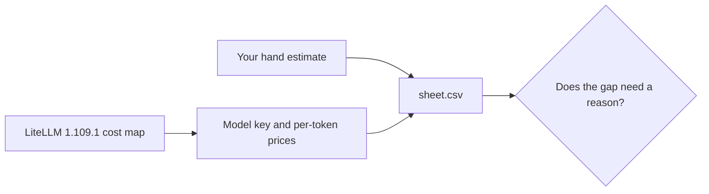

# Price the design

## The problem

In `price-the-outcome` you worked out the monthly model cost by hand. You typed the prices in yourself,
so the figure is only as good as your typing. Teams that run agents avoid this. They read prices from one
shared list.



## Watch it done

Run the check on the starter:

```bash
bun run verify price-the-design
```

Expect:

```text
FAIL  every price cell names a model key from the LiteLLM cost map and the LiteLLM version
FAIL  the recomputed monthly cost is filled in and matches the cost map prices
0 of 2 rules pass. Fix the FAIL lines and run it again.
```

Then on the finished answer:

```bash
bun run verify price-the-design solution
```

Expect:

```text
Done. All 2 rules pass.
```

## Your turn

LiteLLM is an open-source tool that sits between an app and its model providers. It ships a cost map. A cost
map is a file that lists the price per token of each model, under a model key such as the one in
`config/models.ts`. This course pins LiteLLM `1.109.1`, and `config/litellm-cost-map.csv` holds a copy of
the Claude and GPT rows from that release.

For example, one key holds three prices: input, cached input and output, each in dollars per token. Multiply
them by the tokens of one call and you have the cost of that call.

Open `sheet.csv`. It lists the model calls of the sample design, with the hand estimate for a storm month
already filled in. Fill the last three columns on every row:

- `model_key`: the key from `config/litellm-cost-map.csv` for the model that role uses. The ids in
  `config/models.ts` are those keys.
- `litellm_version`: the LiteLLM release you read the price from.
- `litellm_monthly_usd`: the storm month cost at that key's prices. A storm month has 420 outages.

Each row costs `calls_per_outcome` times one call, times 420. One call has three parts. Fresh input tokens use the input price. Cached input tokens use the cached price.
Output tokens use the output price.

Then run the check:

```bash
bun run verify price-the-design
```

Expect: `Done. All 2 rules pass.` and a `Progress:` line.

Last, put the two totals side by side. If your figure differs from the hand estimate, write one sentence on
why. A person reads that sentence, not the script.

Then run the check and fix each FAIL line it prints:

```bash
bun run verify price-the-design
```

## Do it on your work

Make the same move on your own system. Use your own tools, people and numbers, not the storm desk.

Good looks like this: a stranger can read it and name your tool, your person and your number.

## Done when

- Every price cell names a model key from the cost map and the LiteLLM version.
- The recomputed monthly cost is filled in and matches the prices of that key.

## Solution

The finished files are in the `solution/` folder. To see what changed, run:

```bash
diff -r problem solution
```

Expect: only the parts you fill in are different.

Stuck, or a word you do not know? Open [HELP.md](HELP.md).
