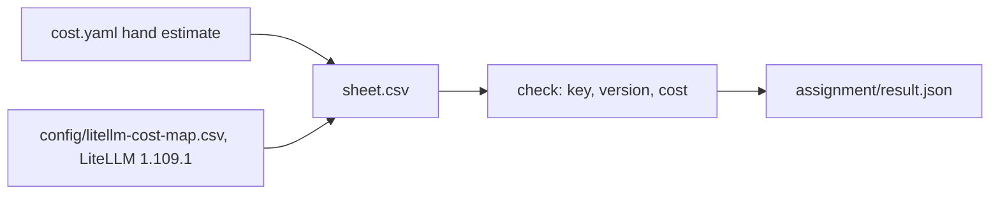

# Price the design with LiteLLM

## The problem

You priced the outage desk by hand. Each price came from a page you read and typed into `cost.yaml`.
A team with three providers cannot keep that up. One list of prices, shared by every service, is easier.

LiteLLM is an open-source tool that many teams run between their apps and their model providers. It
publishes a cost map, the list of per-token prices. For example, your `plan-the-crews` call has a hand price per month. The cost map gives a second price for the same call. In this part you redo your cost estimate with that map
and compare it with the one you made by hand.

This part is optional in a live session. It is the take-home assignment. Nothing earlier in the course
changes, and you still build each idea by hand first.



Read the diagram from left to right. The sheet holds your hand estimate. You add the model key, the version
and the cost from the map. The check reads the sheet and writes a result file.

| Step               | Minutes | You produce                                                           |
| ------------------ | ------- | --------------------------------------------------------------------- |
| `price-the-design` | 15      | `sheet.csv` with a model key, a LiteLLM version and a recomputed cost |

## Walkthrough

First, see a filled sheet pass. This runs the check on the sample answer:

```bash
bun run verify price-the-design solution
```

Expect: `Done. All 2 rules pass.`

Now fill your own `sheet.csv` in the step's `problem/` folder, then check it.

```bash
bun run verify price-the-design
```

Expect: `Done. All 2 rules pass.` once the three columns are filled.

For the take-home version, see the [assignment](../../assignment/README.md).

## Assignment

The task and its Done-when lines are in [assignment/README.md](../../assignment/README.md). The script checks
the first two lines. A person reads the rubric.
